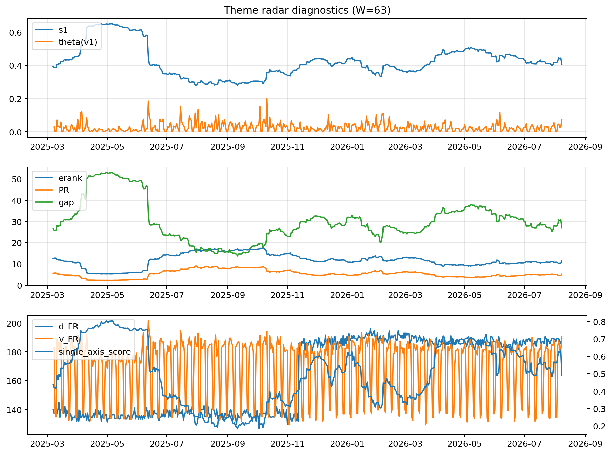

# Theme Radar Daily Brief — 2026-08-08

## Leaders (v1) — W=63
- **Nuclear_Uranium** (0.0888296902642304)
- Semis (0.0715144630246375)
- Quantum (0.0578221683136025)

## Challengers — W=63
**v2:** Rates (0.0876452347075179), Semis (0.0841040709725564), Software_Cloud (0.0724169994935963)
**v3:** Software_Cloud (0.0808926192285754), DataCenter_Infra (0.0786470673388673), Space (0.073530613895531)

## Migration (20D slope) — W=63
**Top risers:**
- axis_Quantum: 0.0004361206659023
- axis_Space: 0.0002361108446721
- axis_Cyber: 0.0002121130513384
- axis_Semis: 0.0001811953323406
- axis_Crypto: 0.0001774763262329
- axis_Commodities: 0.0001650751694593
- axis_Nuclear_Uranium: 0.0001484801774797
- axis_Sector_RealEstate: 0.0001245179058441
- axis_Drones_Autonomy: 0.0001167209455641
- axis_Software_Cloud: 0.0001096972193615

**Top fallers:**
- axis_MegaCap_AI: -7.569148315545102e-05
- axis_Critical_Minerals: -0.0001192195194441
- axis_Sector_ConsDisc: -0.0001212154055714
- axis_USD: -0.0001266586223269
- axis_Miners: -0.0001309620620495
- axis_Credit: -0.0001486756375854
- axis_Sector_Materials: -0.0001682268308723
- axis_Sector_Comm: -0.0001743067626715
- axis_Metals: -0.0002204901625045
- axis_Rates: -0.0006439514780789

## Risk line (W=63)
- s1: 0.4073766119370764
- theta_v1: 0.0719302092057295
- v_FR: 190.37343449454283
- single_axis_score: 0.4923076923076923

## Interpretation
**Regime:** `structure_rewrite`

- Action: Tomorrow watchlist: Quantum, Space, Cyber, Semis, Crypto + v2_top1=Rates
- Action: Hedge note: v_FR high + theta high → correlation structure unstable; diversify hedges / reduce reliance on static correlations.

- Percentiles (W=63 history): vfr_pct=0.95, theta_pct=0.94, s1_pct=0.47, score_pct=0.46.

---
**BUNDLE_ROOT_SHA256:** `7a84a3bef2287b020967946df069d8bd9c58a1aee636ace803c355c645c65818`
