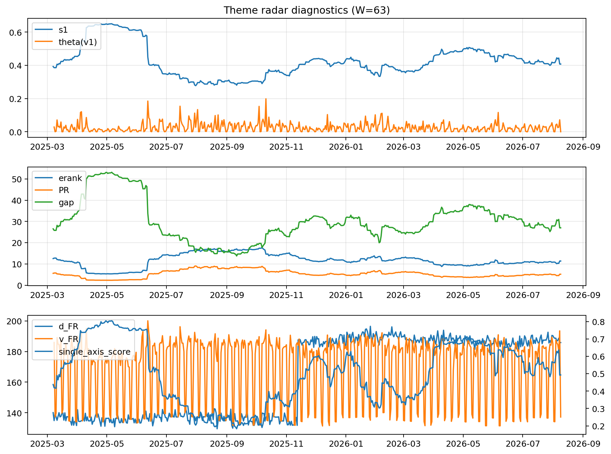

# Theme Radar Daily Brief — 2026-08-09

## Leaders (v1) — W=63
- **Nuclear_Uranium** (0.0888293928087892)
- Semis (0.0715134028419507)
- Quantum (0.0578217641117573)

## Challengers — W=63
**v2:** Rates (0.0876479034750483), Semis (0.0841076107691451), Software_Cloud (0.0724172005654143)
**v3:** Software_Cloud (0.0808863056085517), DataCenter_Infra (0.0786437657741103), Space (0.0735291480824111)

## Migration (20D slope) — W=63
**Top risers:**
- axis_Quantum: 0.0003802545930245
- axis_Commodities: 0.0002829278490551
- axis_Cyber: 0.0002248969712391
- axis_Space: 0.0002048260887754
- axis_Semis: 0.0001884691456452
- axis_Nuclear_Uranium: 0.0001359224933176
- axis_Software_Cloud: 0.0001250778448666
- axis_Sector_RealEstate: 0.0001180992553398
- axis_Genomics_Bio: 0.0001012705589779
- axis_Drones_Autonomy: 9.81949597067989e-05

**Top fallers:**
- axis_MegaCap_AI: -8.109254091086512e-05
- axis_Sector_ConsDisc: -0.0001069793969736
- axis_Credit: -0.0001315162592963
- axis_Critical_Minerals: -0.0001349617447239
- axis_USD: -0.0001350172919843
- axis_Sector_Materials: -0.0001516437228618
- axis_Miners: -0.0001589283250408
- axis_Sector_Comm: -0.0001750042552294
- axis_Metals: -0.0002998077444272
- axis_Rates: -0.0006052474585967

## Risk line (W=63)
- s1: 0.4073802183857749
- theta_v1: 7.652927684733261e-05
- v_FR: 137.1950114952466
- single_axis_score: 0.4928982725527831

## Interpretation
**Regime:** `theme_migration`

- Action: Tomorrow watchlist: Quantum, Commodities, Cyber, Space, Semis + v2_top1=Rates
- Action: Hedge note: normal correlation stability.

- Percentiles (W=63 history): vfr_pct=0.20, theta_pct=0.05, s1_pct=0.47, score_pct=0.46.

---
**BUNDLE_ROOT_SHA256:** `099421651f3336057db6bcfa2821b05eef216a6ee4989763b15a952e7091773e`
