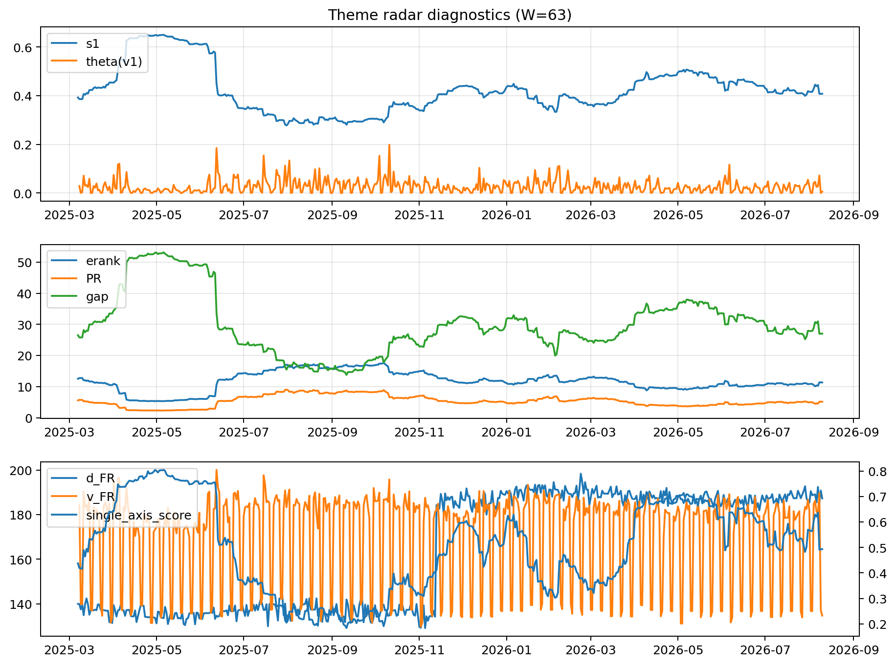

# Theme Radar Daily Brief — 2026-08-10

## Leaders (v1) — W=63
- **Nuclear_Uranium** (0.0887452525966594)
- Semis (0.0714048075853031)
- Quantum (0.057744164190791)

## Challengers — W=63
**v2:** Rates (0.0871974672060792), Semis (0.0841725158942568), Software_Cloud (0.0721111778291829)
**v3:** Software_Cloud (0.0808485673233704), DataCenter_Infra (0.0786370072513574), Space (0.0735180761023568)

## Migration (20D slope) — W=63
**Top risers:**
- axis_Commodities: 0.0003916987958651
- axis_Quantum: 0.0003076730481291
- axis_Cyber: 0.0002441054386366
- axis_Semis: 0.0001783049377701
- axis_Space: 0.0001780942804504
- axis_Software_Cloud: 0.0001463412122962
- axis_Nuclear_Uranium: 0.0001103295213048
- axis_Genomics_Bio: 0.000105057843287
- axis_Sector_RealEstate: 0.0001049721187041
- axis_Grid_Power: 9.97405000398307e-05

**Top fallers:**
- axis_Sector_ConsDisc: -8.986308909580357e-05
- axis_Vol: -9.90727495842924e-05
- axis_Credit: -0.0001111022816983
- axis_Sector_Materials: -0.0001311369808691
- axis_USD: -0.0001343198920656
- axis_Critical_Minerals: -0.000154828856841
- axis_Sector_Comm: -0.0001685013260623
- axis_Miners: -0.0001831829737392
- axis_Metals: -0.0003691068877016
- axis_Rates: -0.0005497611988087

## Risk line (W=63)
- s1: 0.407769928430691
- theta_v1: 0.0056075941083632
- v_FR: 134.76528747708548
- single_axis_score: 0.4931034482758621

## Interpretation
**Regime:** `theme_migration`

- Action: Tomorrow watchlist: Commodities, Quantum, Cyber, Semis, Space + v2_top1=Rates
- Action: Hedge note: normal correlation stability.

- Percentiles (W=63 history): vfr_pct=0.09, theta_pct=0.29, s1_pct=0.47, score_pct=0.46.

---
**BUNDLE_ROOT_SHA256:** `ff22bb1c8feb138580f96d1493e82bf93b69ab4d3dc74a28bde78da6849f7b75`
