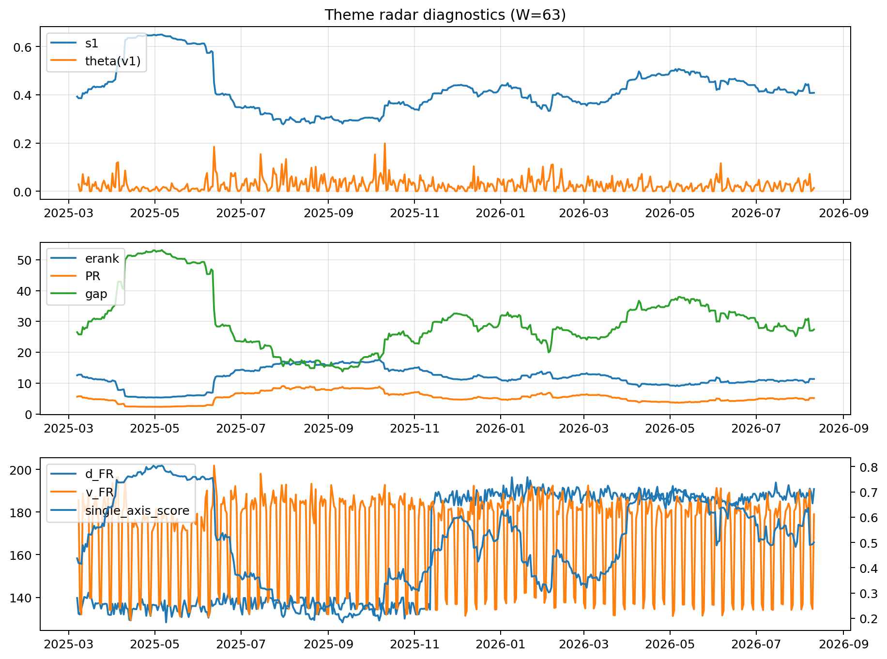

# Theme Radar Daily Brief — 2026-08-11

## Leaders (v1) — W=63
- **Nuclear_Uranium** (0.0883281911548717)
- Semis (0.0719555853222208)
- Quantum (0.0582146465356815)

## Challengers — W=63
**v2:** Rates (0.0848731996164535), Semis (0.0835760463040531), Software_Cloud (0.072843363715525)
**v3:** Software_Cloud (0.0820968595578857), DataCenter_Infra (0.0752120545783254), Rates (0.0738538052696147)

## Migration (20D slope) — W=63
**Top risers:**
- axis_Commodities: 0.0004673951794474
- axis_Quantum: 0.0002455814160977
- axis_Cyber: 0.0002312241381223
- axis_Semis: 0.0001934875379151
- axis_Space: 0.0001609001760757
- axis_DataCenter_Infra: 0.000136425754044
- axis_Software_Cloud: 0.0001328381463968
- axis_Grid_Power: 0.0001243018351442
- axis_Genomics_Bio: 0.0001200857307911
- axis_Sector_Energy: 0.0001034678844854

**Top fallers:**
- axis_Credit: -0.0001049012339531
- axis_MegaCap_AI: -0.0001052805619899
- axis_Sector_Materials: -0.0001082074121088
- axis_Vol: -0.0001193686420209
- axis_USD: -0.0001407241392839
- axis_Critical_Minerals: -0.0001658581764154
- axis_Sector_Comm: -0.0001679989490555
- axis_Miners: -0.0002000383350055
- axis_Metals: -0.0004263742962055
- axis_Rates: -0.0005150680887306

## Risk line (W=63)
- s1: 0.4081470414284544
- theta_v1: 0.0136799622063031
- v_FR: 178.98293596504172
- single_axis_score: 0.5005736137667304

## Interpretation
**Regime:** `theme_migration`

- Action: Tomorrow watchlist: Commodities, Quantum, Cyber, Semis, Space + v2_top1=Rates
- Action: Hedge note: normal correlation stability.

- Percentiles (W=63 history): vfr_pct=0.43, theta_pct=0.40, s1_pct=0.47, score_pct=0.47.

---
**BUNDLE_ROOT_SHA256:** `6add90f46a86e3fb692bd2b738df62f0f2e57985a427be3ee477b2d9c32730c8`
