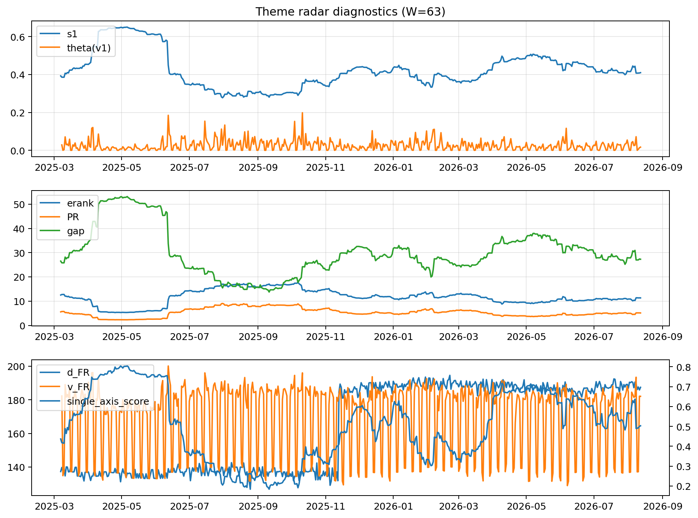

# Theme Radar Daily Brief — 2026-08-12

## Leaders (v1) — W=63
- **Nuclear_Uranium** (0.0881178277939712)
- Semis (0.0717651330542192)
- Quantum (0.0583443501282016)

## Challengers — W=63
**v2:** Semis (0.0833329324658435), Rates (0.0810454097626341), Software_Cloud (0.0761948169848228)
**v3:** MegaCap_AI (0.0853170253507539), DataCenter_Infra (0.0833916989576893), Software_Cloud (0.0819020542857215)

## Migration (20D slope) — W=63
**Top risers:**
- axis_Commodities: 0.0005219244033195
- axis_Semis: 0.0002104208905385
- axis_Cyber: 0.0002045330524638
- axis_DataCenter_Infra: 0.0001990150806873
- axis_Quantum: 0.0001762847544158
- axis_Grid_Power: 0.0001638558027515
- axis_Sector_Energy: 0.0001391540326708
- axis_Defense: 0.0001377994152657
- axis_Space: 0.000134011722286
- axis_Genomics_Bio: 0.0001301041234298

**Top fallers:**
- axis_Credit: -8.892897630891978e-05
- axis_Crypto: -0.0001157433146041
- axis_Vol: -0.0001335839335294
- axis_USD: -0.00014503831687
- axis_MegaCap_AI: -0.0001493480715548
- axis_Sector_Comm: -0.0001638979074781
- axis_Critical_Minerals: -0.0001646826007021
- axis_Miners: -0.0002153836376643
- axis_Rates: -0.0004733300438778
- axis_Metals: -0.0004805949438885

## Risk line (W=63)
- s1: 0.4096802031259038
- theta_v1: 0.0170071137891702
- v_FR: 182.0694649961345
- single_axis_score: 0.5030534351145037

## Interpretation
**Regime:** `theme_migration`

- Action: Tomorrow watchlist: Commodities, Semis, Cyber, DataCenter_Infra, Quantum + v2_top1=Semis
- Action: Hedge note: normal correlation stability.

- Percentiles (W=63 history): vfr_pct=0.58, theta_pct=0.45, s1_pct=0.50, score_pct=0.47.

---
**BUNDLE_ROOT_SHA256:** `dac8bcadc6c3c17ebfb9207ad98ca9e5c36ef9cb65622a9660e42a33b77270aa`
