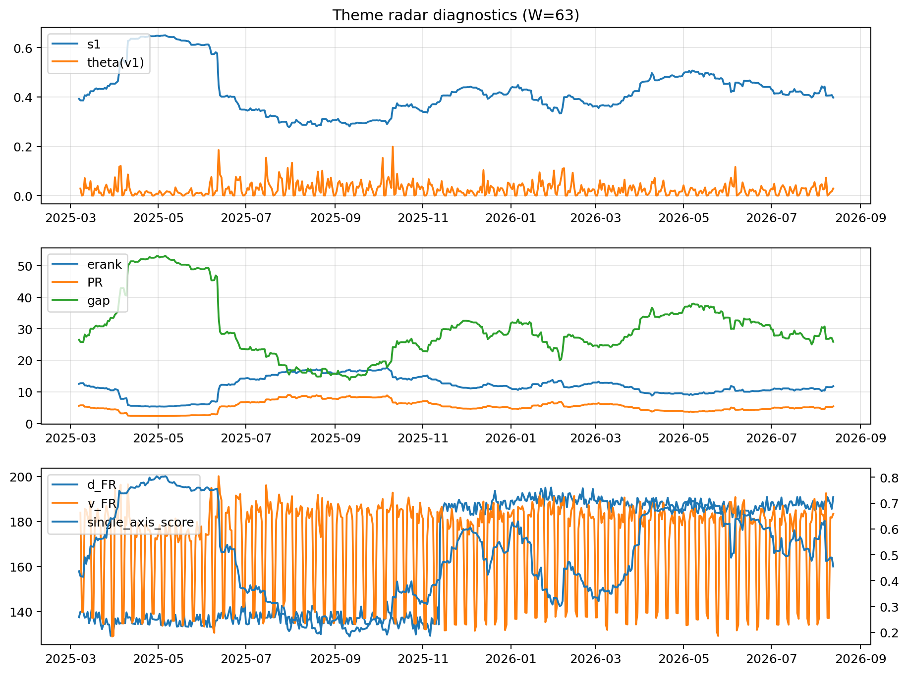

# Theme Radar Daily Brief — 2026-08-13

## Leaders (v1) — W=63
- **Nuclear_Uranium** (0.0881768733236376)
- Semis (0.0729703578293701)
- Quantum (0.0608172104176585)

## Challengers — W=63
**v2:** Semis (0.0810620941632954), Rates (0.0778925267013013), Software_Cloud (0.0747027167820331)
**v3:** MegaCap_AI (0.0868639144288822), Software_Cloud (0.0833997120239263), DataCenter_Infra (0.0824315142879801)

## Migration (20D slope) — W=63
**Top risers:**
- axis_Commodities: 0.0005621823561952
- axis_Semis: 0.0002524824814183
- axis_DataCenter_Infra: 0.0002336231670455
- axis_Grid_Power: 0.0001843664856787
- axis_Quantum: 0.0001830483759423
- axis_Cyber: 0.0001694150074092
- axis_Sector_Energy: 0.0001659670349195
- axis_Defense: 0.0001564143331759
- axis_Space: 0.0001286557985908
- axis_Sector_Fin: 9.696206374974458e-05

**Top fallers:**
- axis_Credit: -0.0001364000655882
- axis_Vol: -0.0001451204026765
- axis_USD: -0.0001460264086175
- axis_Crypto: -0.0001540209112253
- axis_Critical_Minerals: -0.0001545047040306
- axis_Sector_Comm: -0.0001600028487009
- axis_MegaCap_AI: -0.0001990900328794
- axis_Miners: -0.0002236319697625
- axis_Rates: -0.0004150801194851
- axis_Metals: -0.0005235557673254

## Risk line (W=63)
- s1: 0.3970634659109968
- theta_v1: 0.0289380973207895
- v_FR: 183.4497736649932
- single_axis_score: 0.4548571428571428

## Interpretation
**Regime:** `theme_migration`

- Action: Tomorrow watchlist: Commodities, Semis, DataCenter_Infra, Grid_Power, Quantum + v2_top1=Semis
- Action: Hedge note: normal correlation stability.

- Percentiles (W=63 history): vfr_pct=0.67, theta_pct=0.65, s1_pct=0.39, score_pct=0.41.

---
**BUNDLE_ROOT_SHA256:** `8e4be40979db9ab25809d45168f12afcfabc3e83f333b84033d7cd4bf2ac3f38`
