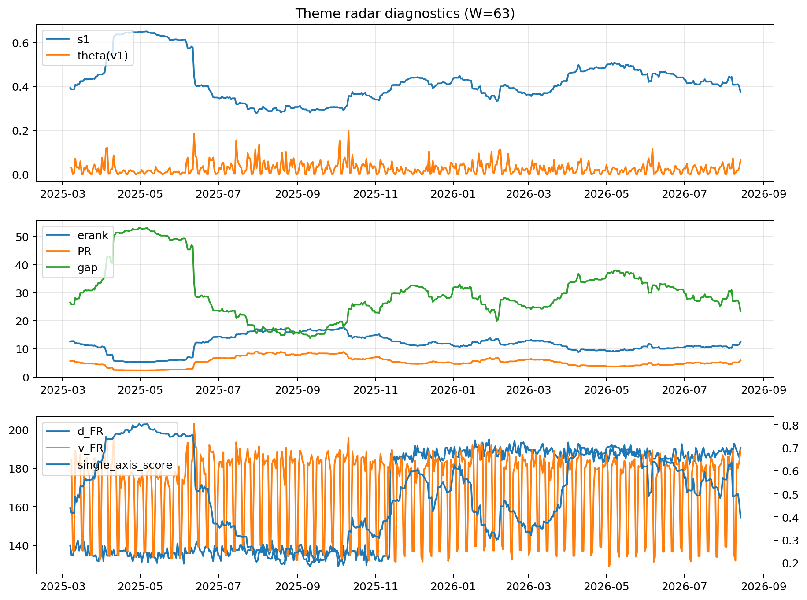

# Theme Radar Daily Brief — 2026-08-14

## Leaders (v1) — W=63
- **Nuclear_Uranium** (0.0907645378377532)
- Semis (0.0753262956000631)
- Quantum (0.0649253775557116)

## Challengers — W=63
**v2:** Rates (0.0845995405685314), Software_Cloud (0.0798082060045817), Semis (0.0772698339115411)
**v3:** Metals (0.107679937102874), DataCenter_Infra (0.0723327533656262), Crypto (0.0722710238373272)

## Migration (20D slope) — W=63
**Top risers:**
- axis_Commodities: 0.0005727357174201
- axis_Semis: 0.0003135129974472
- axis_Quantum: 0.0002589723243215
- axis_Grid_Power: 0.0002058780871242
- axis_DataCenter_Infra: 0.0001989223147399
- axis_Sector_Energy: 0.0001842500885972
- axis_Defense: 0.0001421383660285
- axis_Cyber: 0.0001391449925444
- axis_Genomics_Bio: 0.0001259569167548
- axis_Sector_Health: 0.0001190361736395

**Top fallers:**
- axis_Sector_Materials: -9.555450904339164e-05
- axis_Critical_Minerals: -0.0001394616491342
- axis_USD: -0.0001488244006529
- axis_Vol: -0.0001568476076545
- axis_Sector_Comm: -0.0001634732604422
- axis_Crypto: -0.0002007267896115
- axis_MegaCap_AI: -0.0002121353728897
- axis_Miners: -0.0002428486266014
- axis_Rates: -0.0004487240909344
- axis_Metals: -0.0005917333683919

## Risk line (W=63)
- s1: 0.3729336591889026
- theta_v1: 0.0647766488637919
- v_FR: 189.41049392592265
- single_axis_score: 0.3973384030418251

## Interpretation
**Regime:** `structure_rewrite`

- Action: Tomorrow watchlist: Commodities, Semis, Quantum, Grid_Power, DataCenter_Infra + v2_top1=Rates
- Action: Hedge note: v_FR high + theta high → correlation structure unstable; diversify hedges / reduce reliance on static correlations.

- Percentiles (W=63 history): vfr_pct=0.95, theta_pct=0.92, s1_pct=0.33, score_pct=0.34.

---
**BUNDLE_ROOT_SHA256:** `5ef8d6561fdcb65ca0272d10a76e57fcf537996127430c6a16d4f16e34339c6e`
