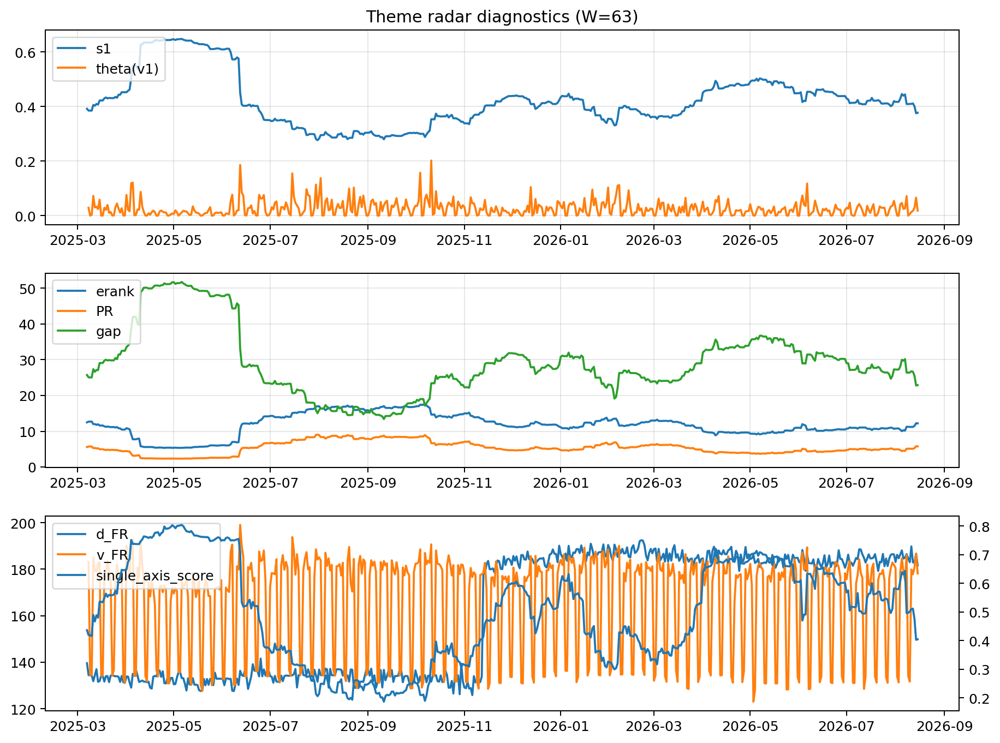

# Theme Radar Daily Brief — 2026-08-15

## Leaders (v1) — W=63
- **Nuclear_Uranium** (0.0922614517777562)
- Semis (0.0764055959748528)
- Quantum (0.0661609224715955)

## Challengers — W=63
**v2:** Rates (0.0863665285582515), Software_Cloud (0.0819928477043641), Semis (0.074934016432008)
**v3:** Metals (0.1237635209480243), Crypto (0.0801627996592297), MegaCap_AI (0.0659343511658728)

## Migration (20D slope) — W=63
**Top risers:**
- axis_Commodities: 0.000581013473762
- axis_Semis: 0.0003464617765589
- axis_Quantum: 0.0003172891602984
- axis_Grid_Power: 0.0002148462257597
- axis_Sector_Energy: 0.0002039620331155
- axis_DataCenter_Infra: 0.0001750873723678
- axis_Genomics_Bio: 0.0001624358812815
- axis_Space: 0.000147482949596
- axis_Sector_Health: 0.0001469076173469
- axis_Defense: 0.0001410376263506

**Top fallers:**
- axis_Sector_Materials: -0.0001199832916523
- axis_Critical_Minerals: -0.0001300524482425
- axis_USD: -0.0001515337318354
- axis_Sector_Comm: -0.0001600987123908
- axis_Vol: -0.0001639830338857
- axis_MegaCap_AI: -0.0002096920799408
- axis_Crypto: -0.0002392549556174
- axis_Miners: -0.0002580494946813
- axis_Rates: -0.0004779746561568
- axis_Metals: -0.0006508926246326

## Risk line (W=63)
- s1: 0.3772400783212682
- theta_v1: 0.0184152815588312
- v_FR: 178.16033612469928
- single_axis_score: 0.4045540796963946

## Interpretation
**Regime:** `theme_migration`

- Action: Tomorrow watchlist: Commodities, Semis, Quantum, Grid_Power, Sector_Energy + v2_top1=Rates
- Action: Hedge note: normal correlation stability.

- Percentiles (W=63 history): vfr_pct=0.54, theta_pct=0.47, s1_pct=0.34, score_pct=0.35.

---
**BUNDLE_ROOT_SHA256:** `3d10d38bd825ba5f25ccc92a1dba1ee9b447238beeaea3b0952d7bf88cd05ec1`
