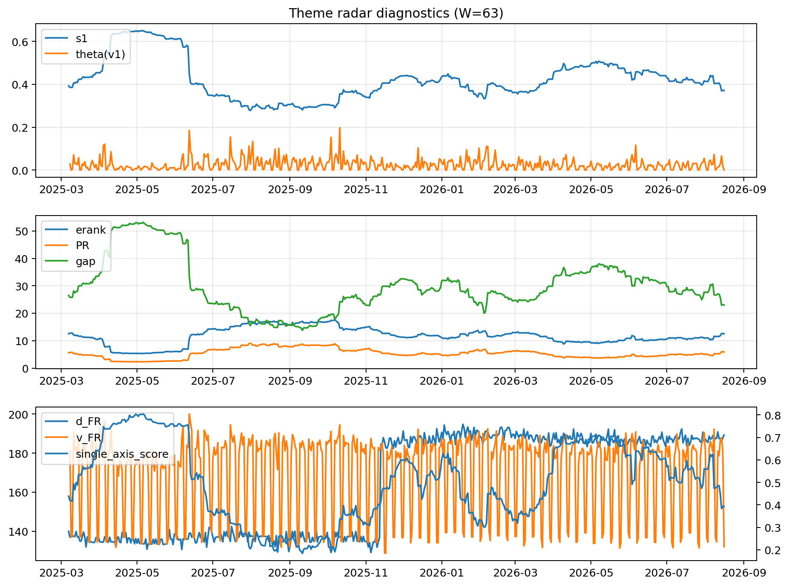

# Theme Radar Daily Brief — 2026-08-16

## Leaders (v1) — W=63
- **Nuclear_Uranium** (0.0883090565298773)
- Semis (0.0751735810985604)
- Quantum (0.065046591627122)

## Challengers — W=63
**v2:** Rates (0.0855116211547264), Software_Cloud (0.0802919993782086), Semis (0.0733703948939315)
**v3:** Metals (0.1162936685283868), Crypto (0.0746757736369294), MegaCap_AI (0.0701998968860247)

## Migration (20D slope) — W=63
**Top risers:**
- axis_Commodities: 0.0005572083609859
- axis_Semis: 0.0004227036560485
- axis_Quantum: 0.0003841095511496
- axis_Grid_Power: 0.0002463438771795
- axis_Sector_Energy: 0.0002140268041749
- axis_Sector_Health: 0.0001797481636982
- axis_Space: 0.0001618120883494
- axis_Robotics: 0.0001187324686593
- axis_DataCenter_Infra: 0.0001183418445709
- axis_Genomics_Bio: 0.0001161158190717

**Top fallers:**
- axis_Sector_Materials: -0.0001347972137371
- axis_USD: -0.0001427585717352
- axis_Sector_Comm: -0.0001596170918335
- axis_Vol: -0.0001649248046189
- axis_Credit: -0.0001794603277228
- axis_MegaCap_AI: -0.0002238347332747
- axis_Miners: -0.0002514865225693
- axis_Crypto: -0.0002679550247914
- axis_Rates: -0.0004692731651381
- axis_Metals: -0.0006686340067717

## Risk line (W=63)
- s1: 0.3712118535045293
- theta_v1: 0.0004505751328389
- v_FR: 132.18362391356266
- single_axis_score: 0.3931818181818182

## Interpretation
**Regime:** `theme_migration`

- Action: Tomorrow watchlist: Commodities, Semis, Quantum, Grid_Power, Sector_Energy + v2_top1=Rates
- Action: Hedge note: normal correlation stability.

- Percentiles (W=63 history): vfr_pct=0.02, theta_pct=0.17, s1_pct=0.33, score_pct=0.34.

---
**BUNDLE_ROOT_SHA256:** `ce5cac7b962dda347d3767b83cbf36d32628fc5841707e2525c5f1f4b295a1de`
