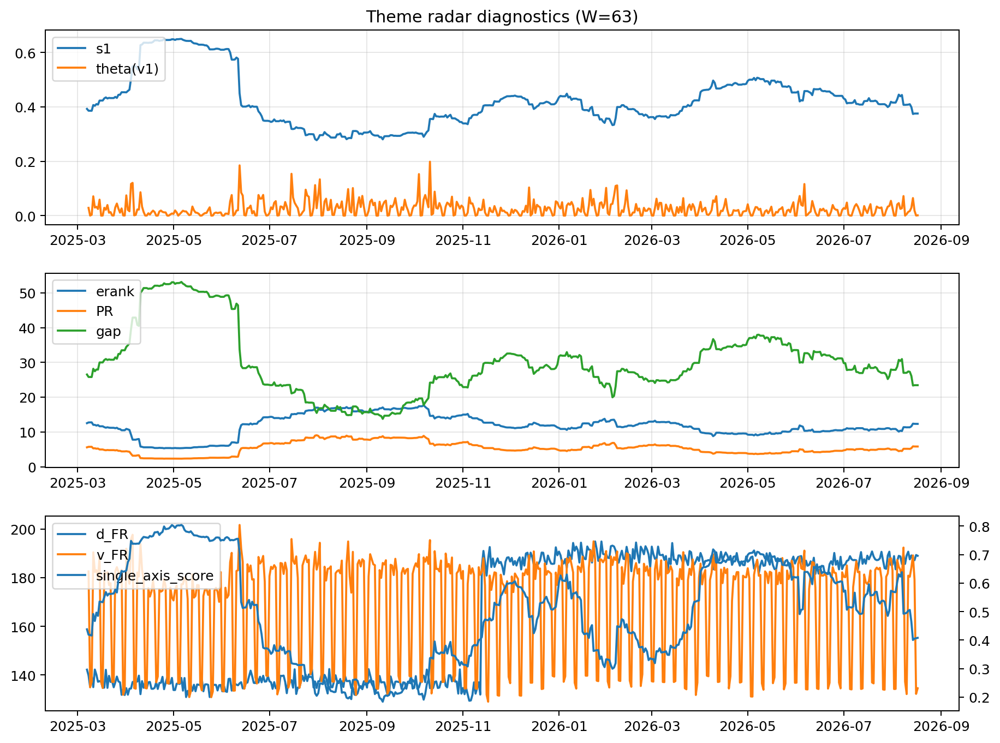

# Theme Radar Daily Brief — 2026-08-17

## Leaders (v1) — W=63
- **Nuclear_Uranium** (0.0902847756211035)
- Semis (0.0745053733071775)
- Quantum (0.0646151660681437)

## Challengers — W=63
**v2:** Rates (0.0861508263885825), Software_Cloud (0.080763125322769), Semis (0.0749928902119279)
**v3:** Metals (0.1181602764298666), Crypto (0.0772666025942842), MegaCap_AI (0.0663428302497484)

## Migration (20D slope) — W=63
**Top risers:**
- axis_Commodities: 0.0005287845871984
- axis_Semis: 0.000406649768483
- axis_Quantum: 0.0003871773977502
- axis_Grid_Power: 0.0002293408116502
- axis_Sector_Energy: 0.000224364125084
- axis_Sector_Health: 0.0001939541355335
- axis_Space: 0.0001639668122607
- axis_Genomics_Bio: 0.0001569303964881
- axis_Robotics: 0.0001322788662403
- axis_Nuclear_Uranium: 0.0001216476915635

**Top fallers:**
- axis_Credit: -0.000124692074953
- axis_USD: -0.0001349956565656
- axis_Sector_Comm: -0.0001380881713272
- axis_Sector_Materials: -0.000139465788508
- axis_Vol: -0.000166692712009
- axis_MegaCap_AI: -0.0002384243007534
- axis_Miners: -0.0002491201375283
- axis_Crypto: -0.0002928897190065
- axis_Rates: -0.0004427738984455
- axis_Metals: -0.0006812797522183

## Risk line (W=63)
- s1: 0.3755452035867386
- theta_v1: 0.0011346268116687
- v_FR: 134.51509683435444
- single_axis_score: 0.4079395085066163

## Interpretation
**Regime:** `theme_migration`

- Action: Tomorrow watchlist: Commodities, Semis, Quantum, Grid_Power, Sector_Energy + v2_top1=Rates
- Action: Hedge note: normal correlation stability.

- Percentiles (W=63 history): vfr_pct=0.11, theta_pct=0.22, s1_pct=0.35, score_pct=0.36.

---
**BUNDLE_ROOT_SHA256:** `4e4f5a38913d69be27890dbc478e1cae9227e201626120c7f9170d3aa01718ff`
