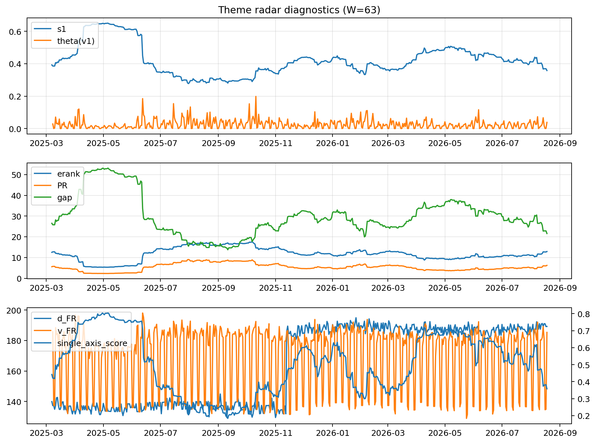

# Theme Radar Daily Brief — 2026-08-18

## Leaders (v1) — W=63
- **Nuclear_Uranium** (0.0902687900049853)
- Semis (0.0767734811613699)
- Quantum (0.0660775213902096)

## Challengers — W=63
**v2:** Rates (0.0902026809601714), Software_Cloud (0.0835486664444211), Semis (0.0708580647808162)
**v3:** Metals (0.1311625867091041), Crypto (0.0930981017332161), Miners (0.0569493638036094)

## Migration (20D slope) — W=63
**Top risers:**
- axis_Commodities: 0.0004860408792959
- axis_Semis: 0.0004672882379484
- axis_Quantum: 0.0004630120304393
- axis_Grid_Power: 0.0002571497655691
- axis_Space: 0.0002196267436076
- axis_Sector_Health: 0.0002146321885811
- axis_Sector_Energy: 0.0002105343028527
- axis_Robotics: 0.0001726379231749
- axis_Nuclear_Uranium: 0.0001236844093892
- axis_Clean_Broad: 0.00011560420342

**Top fallers:**
- axis_USD: -0.0001165399510761
- axis_Sector_ConsDisc: -0.0001246007117493
- axis_Credit: -0.000133714494279
- axis_Vol: -0.0001372235166749
- axis_MegaCap_AI: -0.0002439251957597
- axis_Sector_Materials: -0.0002494137827734
- axis_Miners: -0.0002916387297122
- axis_Crypto: -0.0003337019838824
- axis_Rates: -0.0004519965573238
- axis_Metals: -0.0007157558740155

## Risk line (W=63)
- s1: 0.3579361114932712
- theta_v1: 0.0384019636340581
- v_FR: 185.36339015660675
- single_axis_score: 0.3577358490566037

## Interpretation
**Regime:** `theme_migration`

- Action: Tomorrow watchlist: Commodities, Semis, Quantum, Grid_Power, Space + v2_top1=Rates
- Action: Hedge note: normal correlation stability.

- Percentiles (W=63 history): vfr_pct=0.78, theta_pct=0.77, s1_pct=0.25, score_pct=0.25.

---
**BUNDLE_ROOT_SHA256:** `83afd28ce83b0f543ad8ec6af7b997dc9a648fec115deccdddea99abf6aee59e`
