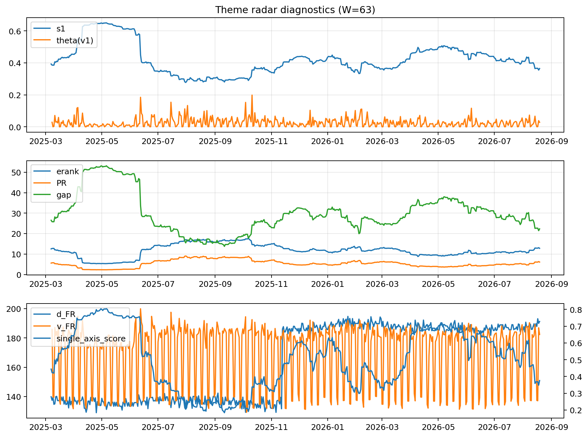

# Theme Radar Daily Brief — 2026-08-19

## Leaders (v1) — W=63
- **Nuclear_Uranium** (0.0912699282706448)
- Semis (0.0771003931207014)
- Quantum (0.0662876099072166)

## Challengers — W=63
**v2:** Software_Cloud (0.0854509265820699), Rates (0.077726266065079), Semis (0.0669045946034919)
**v3:** Metals (0.1299188217415584), Crypto (0.0965335262590774), Miners (0.058157019198268)

## Migration (20D slope) — W=63
**Top risers:**
- axis_Quantum: 0.0005216295246929
- axis_Semis: 0.0005104707390127
- axis_Commodities: 0.0004243507346062
- axis_Grid_Power: 0.0002955421242036
- axis_Space: 0.0002705006067771
- axis_Sector_Health: 0.0002260189559386
- axis_Sector_Energy: 0.0002063502046672
- axis_Robotics: 0.0001943842152978
- axis_Nuclear_Uranium: 0.0001757479550339
- axis_Clean_Broad: 0.0001455549266326

**Top fallers:**
- axis_USD: -0.000121002892477
- axis_Vol: -0.0001284814237882
- axis_Sector_ConsDisc: -0.0001404623257096
- axis_Credit: -0.0001583624848944
- axis_Sector_Materials: -0.0001672442284115
- axis_Miners: -0.0002249641282903
- axis_MegaCap_AI: -0.0002553834996278
- axis_Crypto: -0.0003607283676097
- axis_Metals: -0.0006975671378303
- axis_Rates: -0.0007412220519061

## Risk line (W=63)
- s1: 0.364425158979187
- theta_v1: 0.0283460542511875
- v_FR: 182.33833933208655
- single_axis_score: 0.375894538606403

## Interpretation
**Regime:** `theme_migration`

- Action: Tomorrow watchlist: Quantum, Semis, Commodities, Grid_Power, Space + v2_top1=Software_Cloud
- Action: Hedge note: normal correlation stability.

- Percentiles (W=63 history): vfr_pct=0.61, theta_pct=0.64, s1_pct=0.28, score_pct=0.31.

---
**BUNDLE_ROOT_SHA256:** `31d7f475c7f27b2d3ba336adfc485e308afba39c7315ab377594ee7cea4453fb`
