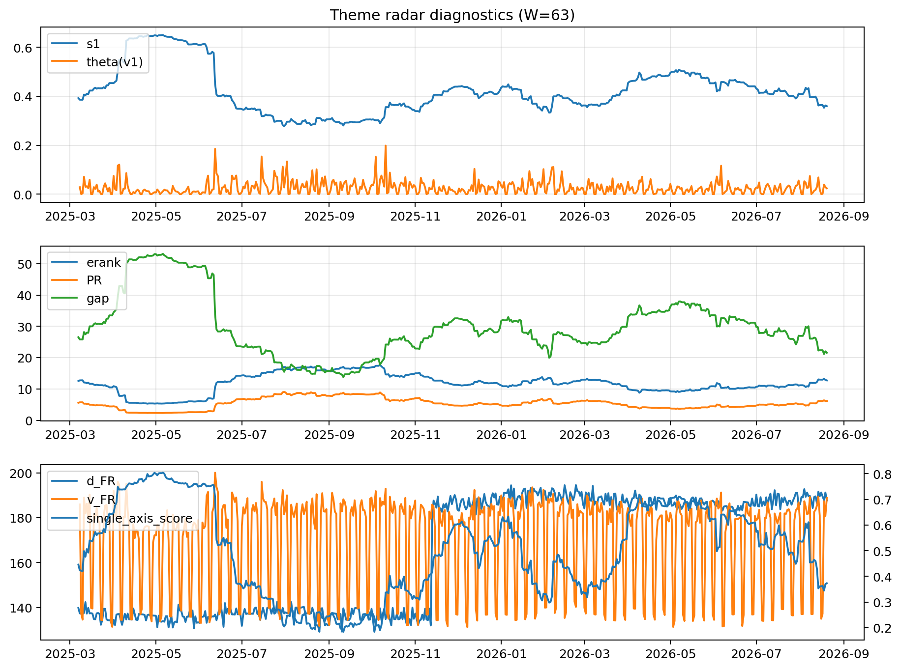

# Theme Radar Daily Brief — 2026-08-20

## Leaders (v1) — W=63
- **Nuclear_Uranium** (0.0928898540332698)
- Semis (0.078260475468556)
- Quantum (0.066277580928243)

## Challengers — W=63
**v2:** Rates (0.0777765089196139), Crypto (0.0717412284365991), Software_Cloud (0.0713404199317022)
**v3:** Metals (0.0982874497479722), Genomics_Bio (0.0826636824303489), Crypto (0.0815741084060034)

## Migration (20D slope) — W=63
**Top risers:**
- axis_Quantum: 0.0005661513831415
- axis_Semis: 0.0005563657825916
- axis_Commodities: 0.0003735141888154
- axis_Grid_Power: 0.0003409672617338
- axis_Space: 0.0003061775219208
- axis_Nuclear_Uranium: 0.0002421313830867
- axis_Sector_Health: 0.0002398188738357
- axis_Robotics: 0.0002144977001425
- axis_Sector_Energy: 0.0001927637796696
- axis_Clean_Broad: 0.0001803141930395

**Top fallers:**
- axis_Sector_ConsDisc: -0.000112385175941
- axis_Software_Cloud: -0.0001336373824636
- axis_Cyber: -0.0001678526213784
- axis_Credit: -0.0002152902509975
- axis_MegaCap_AI: -0.0002176724006252
- axis_Miners: -0.0002570656175911
- axis_Sector_Materials: -0.0002648707837516
- axis_Crypto: -0.0004072817198602
- axis_Metals: -0.0006765536626317
- axis_Rates: -0.0007499316472589

## Risk line (W=63)
- s1: 0.3594348589810615
- theta_v1: 0.0237426901810233
- v_FR: 188.77196466184049
- single_axis_score: 0.3733082706766917

## Interpretation
**Regime:** `structure_rewrite`

- Action: Tomorrow watchlist: Quantum, Semis, Commodities, Grid_Power, Space + v2_top1=Rates
- Action: Hedge note: v_FR high → structure is re-writing; treat correlation assumptions as fragile.

- Percentiles (W=63 history): vfr_pct=0.93, theta_pct=0.57, s1_pct=0.26, score_pct=0.30.

---
**BUNDLE_ROOT_SHA256:** `fde2c1e1e9d57b47440f0f5c4afa3e2c22c3e47ebb9ef689519721b02f7a2799`
