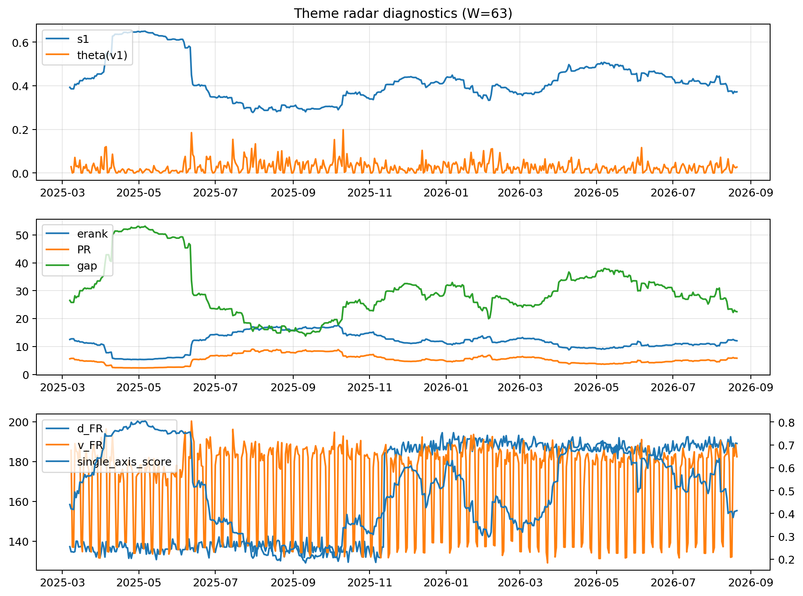

# Theme Radar Daily Brief — 2026-08-21

## Leaders (v1) — W=63
- **Nuclear_Uranium** (0.0930861978869653)
- Semis (0.0753255045760785)
- Quantum (0.064456945533827)

## Challengers — W=63
**v2:** Rates (0.0945177071130183), Software_Cloud (0.0722052533502548), Semis (0.0709718580406096)
**v3:** Metals (0.1005732798947575), Crypto (0.0974315199823223), Genomics_Bio (0.0807409623501062)

## Migration (20D slope) — W=63
**Top risers:**
- axis_Quantum: 0.0005301351888467
- axis_Semis: 0.0004948463339087
- axis_Commodities: 0.0003182516077719
- axis_Space: 0.0002966619010423
- axis_Grid_Power: 0.0002933319351748
- axis_Nuclear_Uranium: 0.0002847218278903
- axis_Sector_Health: 0.0002127407972905
- axis_Robotics: 0.0002046031848154
- axis_Clean_Broad: 0.0001800884625849
- axis_Sector_Energy: 0.0001523462509784

**Top fallers:**
- axis_Sector_Comm: -0.0001554983078037
- axis_Credit: -0.0001702841742125
- axis_Sector_Materials: -0.0001818757902142
- axis_Miners: -0.0001889984855393
- axis_Cyber: -0.0002286904526867
- axis_Software_Cloud: -0.0002558575391077
- axis_MegaCap_AI: -0.0002584754014799
- axis_Crypto: -0.0004317697695309
- axis_Rates: -0.0005767744760439
- axis_Metals: -0.0005893641103882

## Risk line (W=63)
- s1: 0.371948879307109
- theta_v1: 0.0271962154953407
- v_FR: 182.38863660648408
- single_axis_score: 0.4123827392120075

## Interpretation
**Regime:** `theme_migration`

- Action: Tomorrow watchlist: Quantum, Semis, Commodities, Space, Grid_Power + v2_top1=Rates
- Action: Hedge note: normal correlation stability.

- Percentiles (W=63 history): vfr_pct=0.61, theta_pct=0.61, s1_pct=0.33, score_pct=0.36.

---
**BUNDLE_ROOT_SHA256:** `c7370cde160fb9e3c263434c415a29ed9e002e170565ec5038b7c37f47e3e081`
