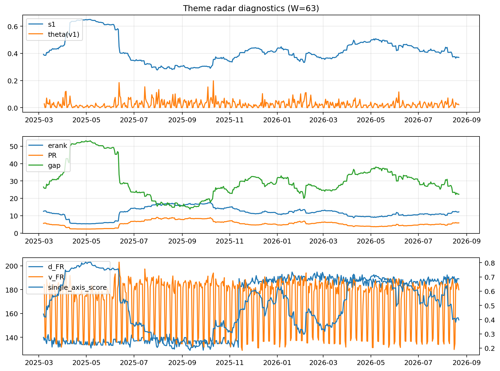

# Theme Radar Daily Brief — 2026-08-22

## Leaders (v1) — W=63
- **Nuclear_Uranium** (0.0920632402715107)
- Semis (0.0749085750161188)
- Quantum (0.0644460446074387)

## Challengers — W=63
**v2:** Rates (0.0883578775270922), Semis (0.0730418088161798), Software_Cloud (0.0718543115224389)
**v3:** Metals (0.1012858548502945), Crypto (0.0974244265700481), Genomics_Bio (0.079108472961503)

## Migration (20D slope) — W=63
**Top risers:**
- axis_Quantum: 0.0005440926002844
- axis_Semis: 0.0004902179520526
- axis_Space: 0.0003295906800065
- axis_Nuclear_Uranium: 0.0003157073607177
- axis_Grid_Power: 0.0002969506871242
- axis_Commodities: 0.0002482066975169
- axis_Robotics: 0.0002098416824806
- axis_Clean_Broad: 0.0001986407175499
- axis_Sector_Health: 0.0001930274584694
- axis_Equity_US: 0.0001470103048454

**Top fallers:**
- axis_Sector_ConsDisc: -0.0001560202826437
- axis_Sector_Comm: -0.0001672144962669
- axis_Credit: -0.0001769049426684
- axis_Sector_Materials: -0.0001783651862729
- axis_Cyber: -0.0002701480816958
- axis_MegaCap_AI: -0.0002743656916943
- axis_Software_Cloud: -0.0003143586246589
- axis_Crypto: -0.0004497827095104
- axis_Metals: -0.0005056522707196
- axis_Rates: -0.0006378879054184

## Risk line (W=63)
- s1: 0.3700332291965126
- theta_v1: 0.0214820581131006
- v_FR: 179.86606751270506
- single_axis_score: 0.39812734082397

## Interpretation
**Regime:** `theme_migration`

- Action: Tomorrow watchlist: Quantum, Semis, Space, Nuclear_Uranium, Grid_Power + v2_top1=Rates
- Action: Hedge note: normal correlation stability.

- Percentiles (W=63 history): vfr_pct=0.45, theta_pct=0.54, s1_pct=0.32, score_pct=0.34.

---
**BUNDLE_ROOT_SHA256:** `72525e364cee824a5d26965383118487e821e23a779b4ebdb164ef53a9659824`
