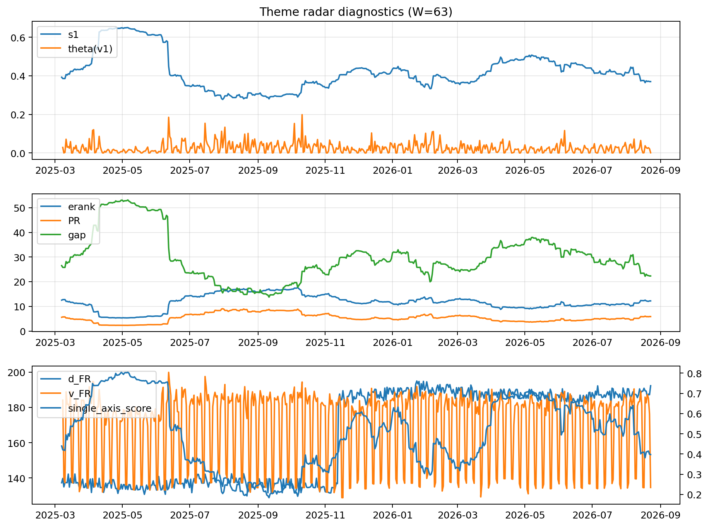

# Theme Radar Daily Brief — 2026-08-23

## Leaders (v1) — W=63
- **Nuclear_Uranium** (0.0920706209997453)
- Semis (0.0749271071169183)
- Quantum (0.0644600978395696)

## Challengers — W=63
**v2:** Rates (0.0883396513019455), Semis (0.0730156432991559), Software_Cloud (0.0719281853855479)
**v3:** Metals (0.1014855653302786), Crypto (0.0971215721690182), Genomics_Bio (0.0792645421211905)

## Migration (20D slope) — W=63
**Top risers:**
- axis_Quantum: 0.0005488326660565
- axis_Semis: 0.0004774658586803
- axis_Space: 0.0003539898299627
- axis_Nuclear_Uranium: 0.0003419549631651
- axis_Grid_Power: 0.0002960816278053
- axis_Clean_Broad: 0.0002143583939835
- axis_Robotics: 0.0002115194597247
- axis_Sector_Health: 0.0001714833849188
- axis_Commodities: 0.0001683581993012
- axis_Equity_US: 0.0001638119833827

**Top fallers:**
- axis_Genomics_Bio: -0.0001662318013503
- axis_Sector_Materials: -0.0001727807469866
- axis_Sector_Comm: -0.0001768365658577
- axis_Credit: -0.0001795192552336
- axis_MegaCap_AI: -0.0002842994811386
- axis_Cyber: -0.0003088631275606
- axis_Software_Cloud: -0.0003728414338915
- axis_Metals: -0.0004087721741917
- axis_Crypto: -0.0004601240234141
- axis_Rates: -0.000681834071159

## Risk line (W=63)
- s1: 0.3699837085153885
- theta_v1: 0.001063115487007
- v_FR: 134.64386096582112
- single_axis_score: 0.3973831775700934

## Interpretation
**Regime:** `theme_migration`

- Action: Tomorrow watchlist: Quantum, Semis, Space, Nuclear_Uranium, Grid_Power + v2_top1=Rates
- Action: Hedge note: normal correlation stability.

- Percentiles (W=63 history): vfr_pct=0.10, theta_pct=0.21, s1_pct=0.31, score_pct=0.34.

---
**BUNDLE_ROOT_SHA256:** `0003e8ed81127de3756f45ce964c121562c3dbd8c516a56d99b0014589e918cf`
