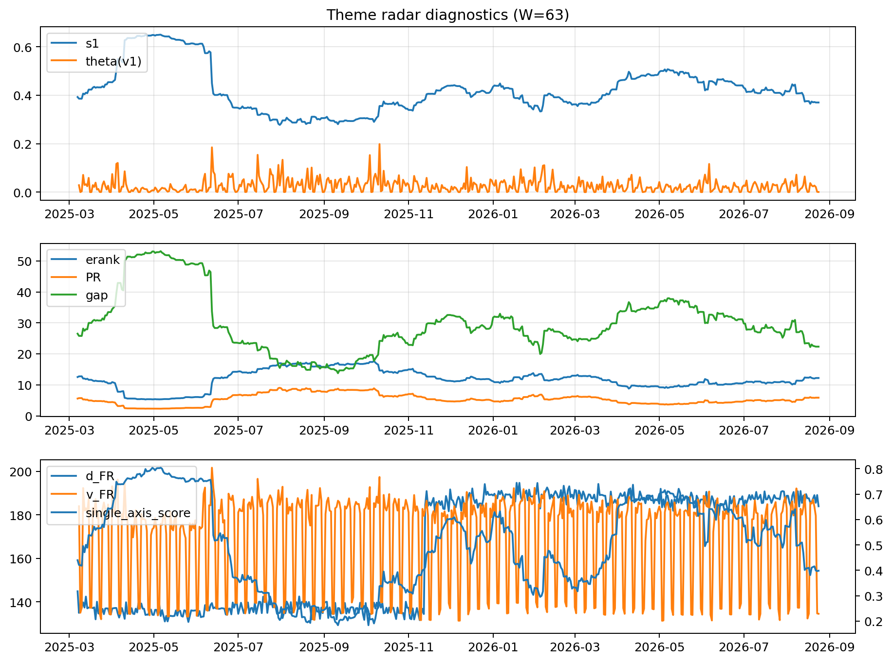

# Theme Radar Daily Brief — 2026-08-24

## Leaders (v1) — W=63
- **Nuclear_Uranium** (0.0920667362727948)
- Semis (0.0749168717981698)
- Quantum (0.0644523015998684)

## Challengers — W=63
**v2:** Rates (0.0883672783000949), Semis (0.0730293436660708), Software_Cloud (0.0719072199268424)
**v3:** Metals (0.1013736640344718), Crypto (0.0972811109467933), Genomics_Bio (0.0792015168291643)

## Migration (20D slope) — W=63
**Top risers:**
- axis_Quantum: 0.0005354847049435
- axis_Semis: 0.000421853493715
- axis_Space: 0.0003885723575692
- axis_Nuclear_Uranium: 0.0003436641775216
- axis_Grid_Power: 0.0002739155619758
- axis_Clean_Broad: 0.0002154231927913
- axis_Robotics: 0.0002020104520832
- axis_Equity_US: 0.0001662897787366
- axis_Equity_ExUS: 0.0001524528836951
- axis_Sector_Health: 0.0001474520759699

**Top fallers:**
- axis_Sector_Materials: -0.0001639081374937
- axis_Sector_Comm: -0.0001668212793336
- axis_Credit: -0.0001785059754572
- axis_Genomics_Bio: -0.0002264335764101
- axis_MegaCap_AI: -0.0002534186474398
- axis_Cyber: -0.0003040482790299
- axis_Metals: -0.0003364492585085
- axis_Software_Cloud: -0.0003620661268686
- axis_Crypto: -0.0004725116694115
- axis_Rates: -0.0007095036024226

## Risk line (W=63)
- s1: 0.3700157726027251
- theta_v1: 0.0006475884149941
- v_FR: 134.50483017194884
- single_axis_score: 0.3985074626865671

## Interpretation
**Regime:** `theme_migration`

- Action: Tomorrow watchlist: Quantum, Semis, Space, Nuclear_Uranium, Grid_Power + v2_top1=Rates
- Action: Hedge note: normal correlation stability.

- Percentiles (W=63 history): vfr_pct=0.09, theta_pct=0.18, s1_pct=0.32, score_pct=0.34.

---
**BUNDLE_ROOT_SHA256:** `a5f67e0e00222bb96f453461debbda27d1c9cdc954e41d3da2fa51fafe15c165`
