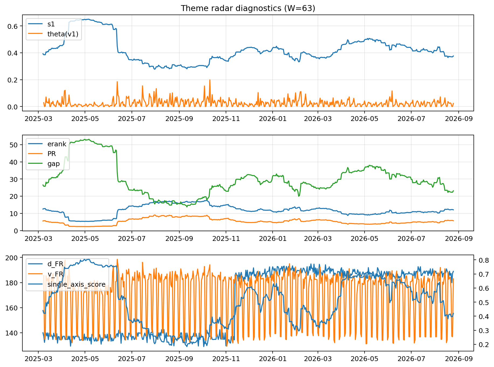

# Theme Radar Daily Brief — 2026-08-25

## Leaders (v1) — W=63
- **Nuclear_Uranium** (0.0917734908434808)
- Semis (0.075544813288504)
- Quantum (0.0643901402287883)

## Challengers — W=63
**v2:** Rates (0.0911758884515246), Genomics_Bio (0.0763670276488742), Semis (0.0743957006357224)
**v3:** Metals (0.104290981505669), Crypto (0.0953893067946231), Genomics_Bio (0.0697229894152765)

## Migration (20D slope) — W=63
**Top risers:**
- axis_Quantum: 0.0004955660926879
- axis_Space: 0.0004163099708119
- axis_Semis: 0.0003389335536372
- axis_Nuclear_Uranium: 0.0003097041325752
- axis_Grid_Power: 0.0002300294878035
- axis_Clean_Broad: 0.0002030721517558
- axis_Robotics: 0.0001743121364244
- axis_Equity_US: 0.0001493236116621
- axis_Equity_ExUS: 0.0001355320107957
- axis_Sector_Health: 0.0001129389120704

**Top fallers:**
- axis_Sector_Comm: -0.0001486692676741
- axis_Sector_Materials: -0.0001493140763444
- axis_Credit: -0.0001861340126615
- axis_Genomics_Bio: -0.0002074014649823
- axis_MegaCap_AI: -0.0002123577371868
- axis_Metals: -0.0002704486904534
- axis_Cyber: -0.0002738189490389
- axis_Software_Cloud: -0.0002843149023333
- axis_Crypto: -0.0004406888704032
- axis_Rates: -0.0007190940876226

## Risk line (W=63)
- s1: 0.3762032916426587
- theta_v1: 0.0229122255313045
- v_FR: 182.95004882289015
- single_axis_score: 0.4201117318435754

## Interpretation
**Regime:** `theme_migration`

- Action: Tomorrow watchlist: Quantum, Space, Semis, Nuclear_Uranium, Grid_Power + v2_top1=Rates
- Action: Hedge note: normal correlation stability.

- Percentiles (W=63 history): vfr_pct=0.64, theta_pct=0.56, s1_pct=0.36, score_pct=0.37.

---
**BUNDLE_ROOT_SHA256:** `54564fcf16ea67b9f5672db7bd795ec92b1513736f556f793813b289ae599548`
