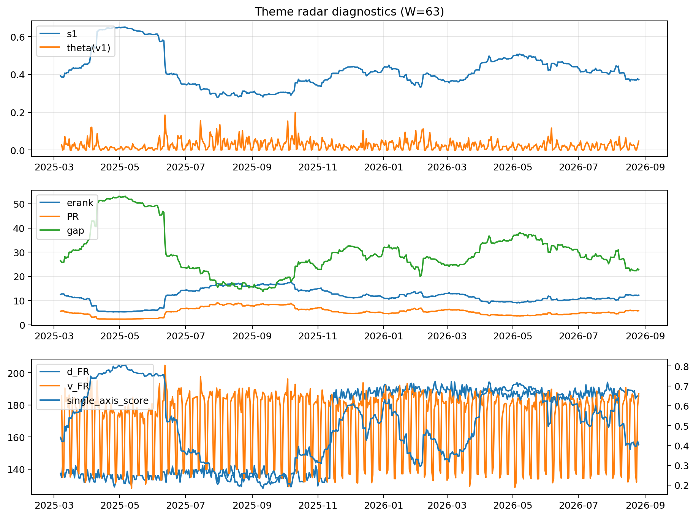

# Theme Radar Daily Brief — 2026-08-26

## Leaders (v1) — W=63
- **Nuclear_Uranium** (0.0943504426527727)
- Semis (0.0739923453893623)
- Quantum (0.0668717406742736)

## Challengers — W=63
**v2:** Rates (0.0872372530894241), Genomics_Bio (0.0808897129017583), Semis (0.0760309093758387)
**v3:** Metals (0.1006906297357278), Crypto (0.0858557175887733), Software_Cloud (0.0717203606037226)

## Migration (20D slope) — W=63
**Top risers:**
- axis_Quantum: 0.0004857400037893
- axis_Space: 0.0004446419570641
- axis_Nuclear_Uranium: 0.0003157463816586
- axis_Semis: 0.0002515296324655
- axis_Clean_Broad: 0.000189258213747
- axis_Grid_Power: 0.0001772658786307
- axis_Robotics: 0.0001483188718111
- axis_Equity_US: 0.0001309138011993
- axis_Equity_ExUS: 0.0001195011845926
- axis_Drones_Autonomy: 9.899641582091629e-05

**Top fallers:**
- axis_Sector_Materials: -0.0001424815122341
- axis_Sector_ConsDisc: -0.0001466043952059
- axis_Genomics_Bio: -0.0001476031595152
- axis_Credit: -0.0001697789703315
- axis_MegaCap_AI: -0.0001754758661315
- axis_Software_Cloud: -0.0002199834751656
- axis_Cyber: -0.0002292194757456
- axis_Metals: -0.0002548836946312
- axis_Crypto: -0.0004447609994044
- axis_Rates: -0.0006585905056582

## Risk line (W=63)
- s1: 0.3719440519160848
- theta_v1: 0.0467519079031586
- v_FR: 186.8483487420673
- single_axis_score: 0.4037174721189591

## Interpretation
**Regime:** `theme_migration`

- Action: Tomorrow watchlist: Quantum, Space, Nuclear_Uranium, Semis, Clean_Broad + v2_top1=Rates
- Action: Hedge note: normal correlation stability.

- Percentiles (W=63 history): vfr_pct=0.86, theta_pct=0.84, s1_pct=0.33, score_pct=0.35.

---
**BUNDLE_ROOT_SHA256:** `b09e48f300cd8388249ce33869b2bf8109487f48faf197d1551b14fb26a5aec2`
