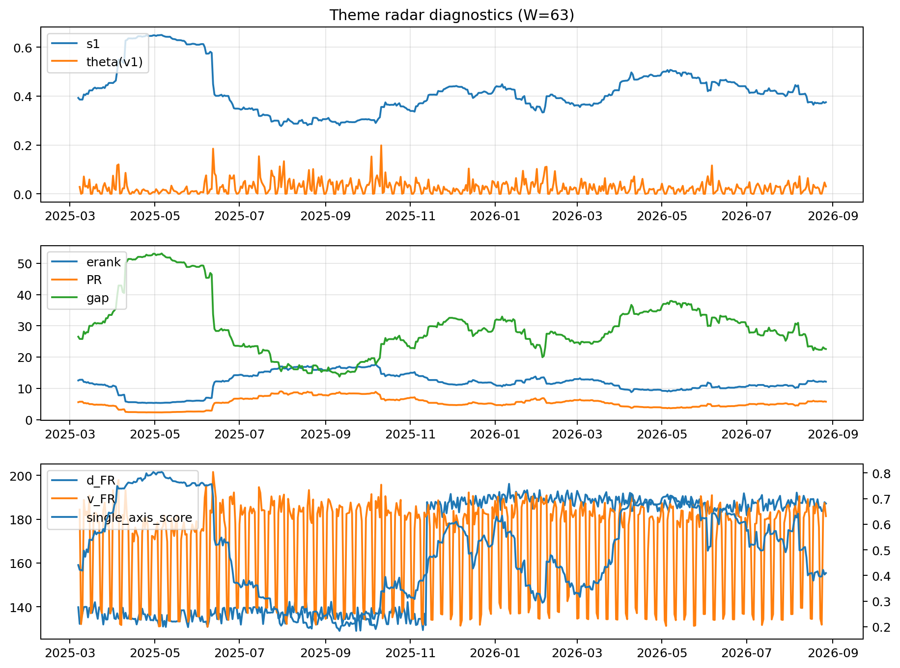

# Theme Radar Daily Brief — 2026-08-27

## Leaders (v1) — W=63
- **Nuclear_Uranium** (0.0929782401417651)
- Semis (0.0732677487554025)
- Quantum (0.0658367932901077)

## Challengers — W=63
**v2:** Rates (0.0870827626883578), Genomics_Bio (0.0804906914621936), Semis (0.0765130374113451)
**v3:** Metals (0.0888072903873134), Software_Cloud (0.0842028585625856), Crypto (0.0703963916768389)

## Migration (20D slope) — W=63
**Top risers:**
- axis_Space: 0.0004480443732288
- axis_Quantum: 0.0004427730824088
- axis_Nuclear_Uranium: 0.0002857668066018
- axis_Semis: 0.0001848483892159
- axis_Clean_Broad: 0.0001615345453574
- axis_Drones_Autonomy: 0.0001180069306619
- axis_Robotics: 0.0001138132943201
- axis_Equity_US: 0.0001061186525022
- axis_Grid_Power: 0.0001023142652669
- axis_Equity_ExUS: 9.71217177193058e-05

**Top fallers:**
- axis_Sector_Comm: -0.0001026919120413
- axis_Sector_Materials: -0.0001282784302033
- axis_Sector_ConsDisc: -0.0001390745324462
- axis_Credit: -0.000142134338405
- axis_MegaCap_AI: -0.0001459187698235
- axis_Software_Cloud: -0.0001503473239556
- axis_Cyber: -0.000181422029353
- axis_Metals: -0.0002272033269065
- axis_Crypto: -0.000439760722494
- axis_Rates: -0.0005332281113925

## Risk line (W=63)
- s1: 0.3748798197681389
- theta_v1: 0.0303566380860303
- v_FR: 181.3892503341405
- single_axis_score: 0.4096474953617811

## Interpretation
**Regime:** `theme_migration`

- Action: Tomorrow watchlist: Space, Quantum, Nuclear_Uranium, Semis, Clean_Broad + v2_top1=Rates
- Action: Hedge note: normal correlation stability.

- Percentiles (W=63 history): vfr_pct=0.54, theta_pct=0.67, s1_pct=0.35, score_pct=0.35.

---
**BUNDLE_ROOT_SHA256:** `b9830afa1566d691c3508175de43359a7d272752452cf4dd7e98de9c42b27c9f`
