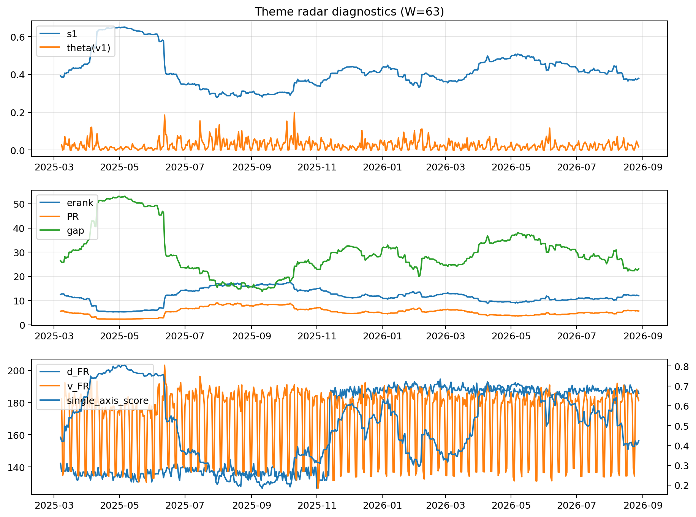

# Theme Radar Daily Brief — 2026-08-28

## Leaders (v1) — W=63
- **Nuclear_Uranium** (0.0930188190207972)
- Semis (0.0738621949539849)
- Quantum (0.0661690933646846)

## Challengers — W=63
**v2:** Rates (0.0908241319676091), Genomics_Bio (0.0882492467301097), Semis (0.0746521507220294)
**v3:** Software_Cloud (0.0834362536182834), Metals (0.0833720469248332), Crypto (0.0681575858855589)

## Migration (20D slope) — W=63
**Top risers:**
- axis_Space: 0.0004468902831796
- axis_Quantum: 0.000406878757866
- axis_Nuclear_Uranium: 0.0002842408617127
- axis_Semis: 0.000142328506299
- axis_Clean_Broad: 0.0001418338123047
- axis_Drones_Autonomy: 0.0001333007951298
- axis_Robotics: 9.506658811655036e-05
- axis_Equity_US: 9.350196802986425e-05
- axis_Sector_Utilities: 9.193528341597002e-05
- axis_Equity_ExUS: 8.07806469200278e-05

**Top fallers:**
- axis_Sector_Comm: -9.700535445008802e-05
- axis_Software_Cloud: -0.0001052221675447
- axis_Sector_Materials: -0.0001198857806242
- axis_Credit: -0.0001258937310846
- axis_Sector_ConsDisc: -0.0001329976277225
- axis_MegaCap_AI: -0.000146614336528
- axis_Cyber: -0.0001529839305883
- axis_Metals: -0.0002194306843625
- axis_Rates: -0.0004554084653678
- axis_Crypto: -0.0004656277660628

## Risk line (W=63)
- s1: 0.3789870078237319
- theta_v1: 0.0175610147342254
- v_FR: 181.21579830524115
- single_axis_score: 0.4229629629629629

## Interpretation
**Regime:** `theme_migration`

- Action: Tomorrow watchlist: Space, Quantum, Nuclear_Uranium, Semis, Clean_Broad + v2_top1=Rates
- Action: Hedge note: normal correlation stability.

- Percentiles (W=63 history): vfr_pct=0.53, theta_pct=0.46, s1_pct=0.36, score_pct=0.38.

---
**BUNDLE_ROOT_SHA256:** `59d183811c0a786249d16e42422bc4d5a5c8711b7401bef292e4d34d0656f4f7`
