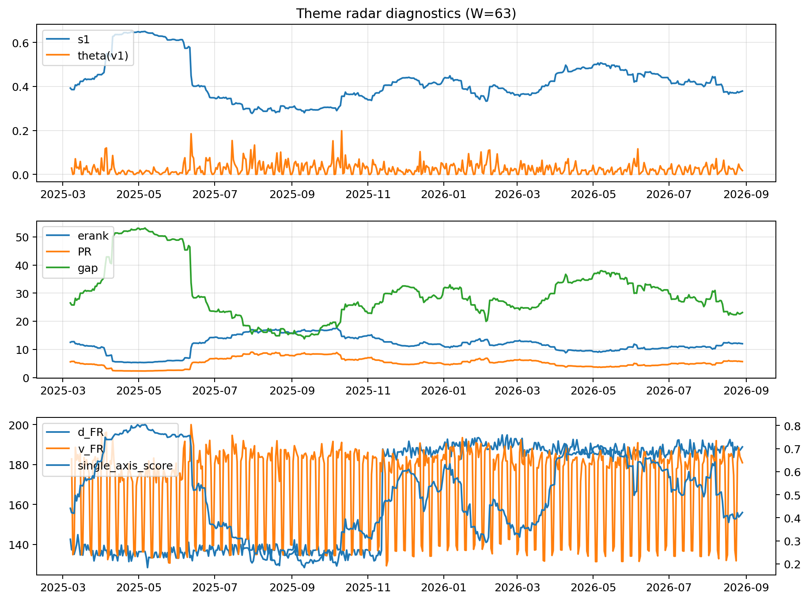

# Theme Radar Daily Brief — 2026-08-29

## Leaders (v1) — W=63
- **Nuclear_Uranium** (0.0930188250423266)
- Semis (0.0738621847575701)
- Quantum (0.0661690907459508)

## Challengers — W=63
**v2:** Rates (0.0908238736864558), Genomics_Bio (0.0882491955053839), Semis (0.074652183573992)
**v3:** Software_Cloud (0.0834362620173277), Metals (0.0833720129942213), Crypto (0.0681576018493299)

## Migration (20D slope) — W=63
**Top risers:**
- axis_Space: 0.0004468899781954
- axis_Quantum: 0.0004068787604909
- axis_Nuclear_Uranium: 0.0002842410463012
- axis_Semis: 0.000142328290807
- axis_Clean_Broad: 0.0001418337344931
- axis_Drones_Autonomy: 0.0001333007430751
- axis_Robotics: 9.506657491297996e-05
- axis_Equity_US: 9.350187992872766e-05
- axis_Sector_Utilities: 9.193531535207398e-05
- axis_Equity_ExUS: 8.078062716172674e-05

**Top fallers:**
- axis_Sector_Comm: -9.70054351383766e-05
- axis_Software_Cloud: -0.000105222031006
- axis_Sector_Materials: -0.0001198856643706
- axis_Credit: -0.0001258933556607
- axis_Sector_ConsDisc: -0.0001329976903619
- axis_MegaCap_AI: -0.000146614675889
- axis_Cyber: -0.0001529838750021
- axis_Metals: -0.0002194305713921
- axis_Rates: -0.0004554091261207
- axis_Crypto: -0.0004656274973944

## Risk line (W=63)
- s1: 0.3789869834621342
- theta_v1: 0.0175610147939722
- v_FR: 180.93197521988336
- single_axis_score: 0.4229629629629629

## Interpretation
**Regime:** `theme_migration`

- Action: Tomorrow watchlist: Space, Quantum, Nuclear_Uranium, Semis, Clean_Broad + v2_top1=Rates
- Action: Hedge note: normal correlation stability.

- Percentiles (W=63 history): vfr_pct=0.50, theta_pct=0.46, s1_pct=0.36, score_pct=0.38.

---
**BUNDLE_ROOT_SHA256:** `8b2bedf12315cd0cd5a5d1918ae7f0203525b3cfbbdb7dd8e7fa012fa6c8b4ef`
