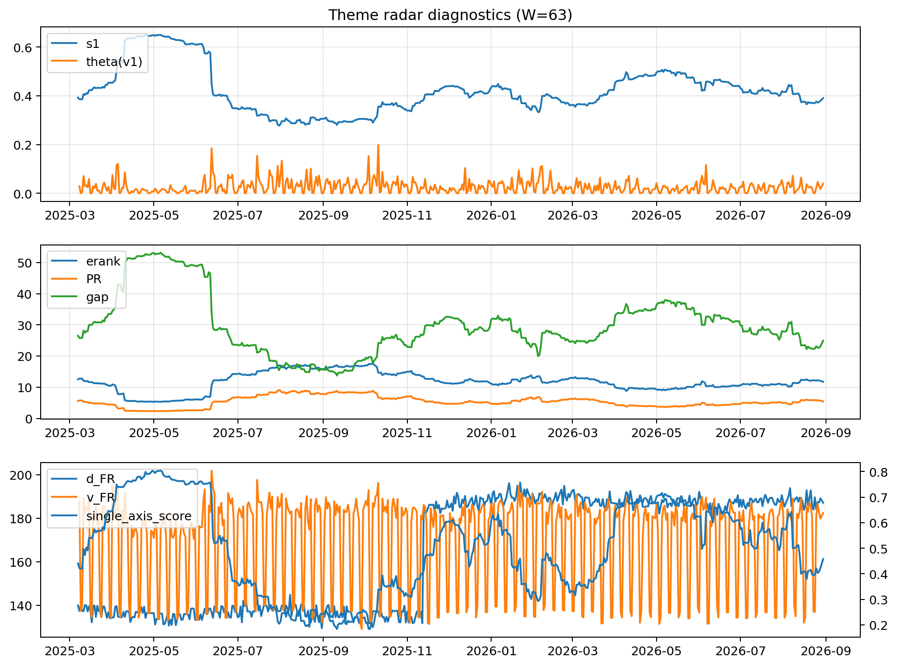

# Theme Radar Daily Brief — 2026-08-30

## Leaders (v1) — W=63
- **Nuclear_Uranium** (0.0915669875680723)
- Semis (0.0726782121496965)
- Quantum (0.0652987299420618)

## Challengers — W=63
**v2:** Rates (0.0912495906933327), Genomics_Bio (0.0861511672652234), Crypto (0.0776576445701271)
**v3:** Software_Cloud (0.0858957640343368), Metals (0.0737610200842032), MegaCap_AI (0.063154012839837)

## Migration (20D slope) — W=63
**Top risers:**
- axis_Space: 0.0004354148767269
- axis_Quantum: 0.0003459921948403
- axis_Nuclear_Uranium: 0.0002556696380572
- axis_Drones_Autonomy: 0.000146039985439
- axis_Clean_Broad: 0.0001201800810285
- axis_Genomics_Bio: 8.71093499194986e-05
- axis_Sector_Utilities: 8.132624461791176e-05
- axis_Semis: 7.934685257440223e-05
- axis_DataCenter_Infra: 7.77584534111865e-05
- axis_USD: 7.347506825600545e-05

**Top fallers:**
- axis_Miners: -8.138409653652487e-05
- axis_Sector_Comm: -8.195937087421616e-05
- axis_Cyber: -0.0001032941089025
- axis_Credit: -0.0001046123559289
- axis_Sector_Materials: -0.0001094989384633
- axis_Sector_ConsDisc: -0.0001325442214655
- axis_MegaCap_AI: -0.0001607578128619
- axis_Metals: -0.0002083492104941
- axis_Rates: -0.0003228084112865
- axis_Crypto: -0.0004527050489801

## Risk line (W=63)
- s1: 0.3906032447872849
- theta_v1: 0.0396584526755294
- v_FR: 182.33480379070087
- single_axis_score: 0.4576709796672828

## Interpretation
**Regime:** `theme_migration`

- Action: Tomorrow watchlist: Space, Quantum, Nuclear_Uranium, Drones_Autonomy, Clean_Broad + v2_top1=Rates
- Action: Hedge note: normal correlation stability.

- Percentiles (W=63 history): vfr_pct=0.60, theta_pct=0.79, s1_pct=0.39, score_pct=0.42.

---
**BUNDLE_ROOT_SHA256:** `1b719bc6bf7399be851b5b188b272f3044d25b4bea9e308476c6687b1b918a9b`
