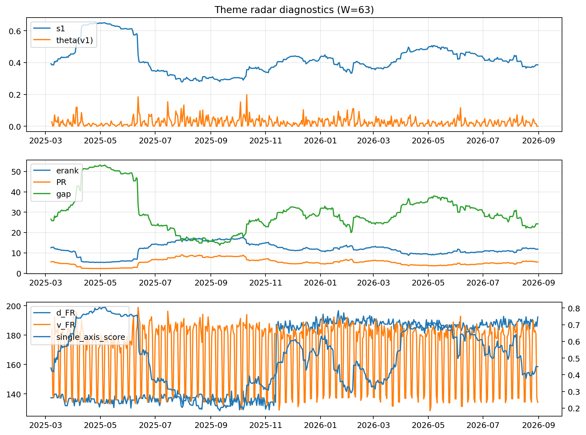

# Theme Radar Daily Brief — 2026-08-31

## Leaders (v1) — W=63
- **Nuclear_Uranium** (0.0920083042290203)
- Semis (0.0731990711859135)
- Quantum (0.0657645347162383)

## Challengers — W=63
**v2:** Rates (0.0914952646134421), Genomics_Bio (0.0860548216627982), Crypto (0.0764762225770807)
**v3:** Software_Cloud (0.0854221091099997), Metals (0.082598362277212), Crypto (0.061767036652761)

## Migration (20D slope) — W=63
**Top risers:**
- axis_Space: 0.0003917934178691
- axis_Quantum: 0.0002131773615159
- axis_Nuclear_Uranium: 0.0001937125791844
- axis_Genomics_Bio: 0.0001674149902404
- axis_Drones_Autonomy: 0.0001582842165736
- axis_Commodities: 0.0001306094942054
- axis_Software_Cloud: 8.627106344264448e-05
- axis_Sector_Utilities: 8.46137695465281e-05
- axis_Clean_Broad: 7.948736483458348e-05
- axis_USD: 5.7936365890880015e-05

**Top fallers:**
- axis_Critical_Minerals: -6.53393169148657e-05
- axis_Credit: -7.071107185655809e-05
- axis_Sector_Materials: -7.151978609636588e-05
- axis_Sector_ConsDisc: -8.703468385087363e-05
- axis_Miners: -9.116111755251224e-05
- axis_MegaCap_AI: -0.0001154630083584
- axis_Sector_Health: -0.0001314325894868
- axis_Metals: -0.0001323800938479
- axis_Rates: -0.0001470955048142
- axis_Crypto: -0.0004573951040281

## Risk line (W=63)
- s1: 0.3856409662229495
- theta_v1: 0.0001105688382129
- v_FR: 134.30512442049664
- single_axis_score: 0.4486187845303867

## Interpretation
**Regime:** `theme_migration`

- Action: Tomorrow watchlist: Space, Quantum, Nuclear_Uranium, Genomics_Bio, Drones_Autonomy + v2_top1=Rates
- Action: Hedge note: normal correlation stability.

- Percentiles (W=63 history): vfr_pct=0.06, theta_pct=0.07, s1_pct=0.38, score_pct=0.41.

---
**BUNDLE_ROOT_SHA256:** `a357eb4f2b4d7cd3fc3cceb70686bf103e2511b86711dec07f33c2dd93ff92b0`
