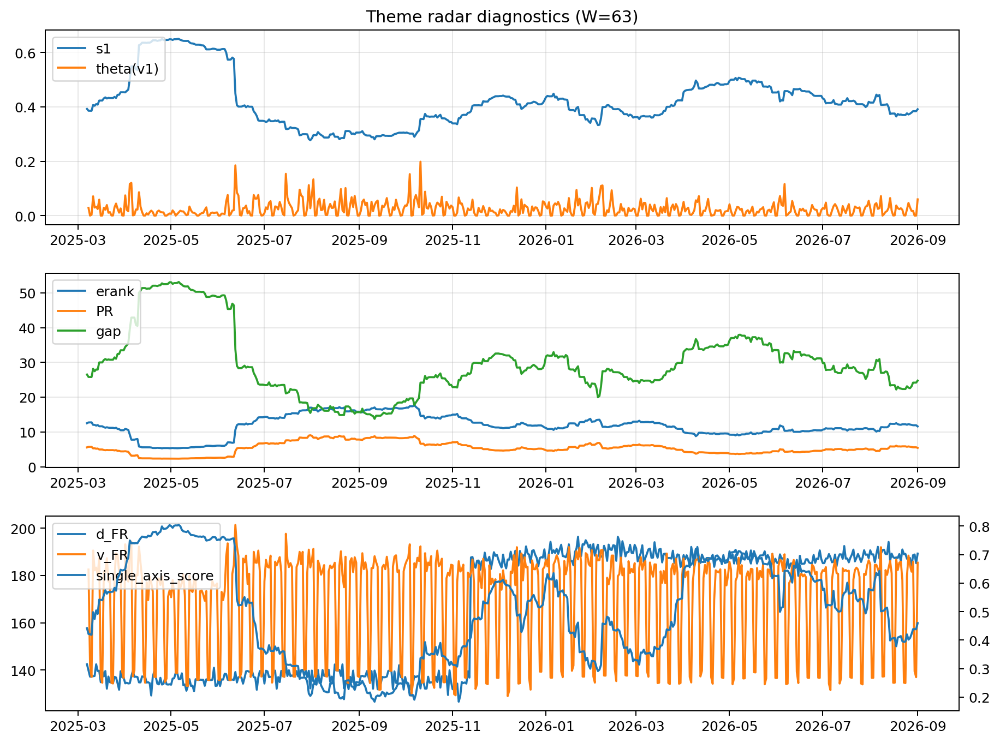

# Theme Radar Daily Brief — 2026-09-01

## Leaders (v1) — W=63
- **Nuclear_Uranium** (0.0924703202866406)
- Semis (0.0710760540662748)
- Quantum (0.0635947272922081)

## Challengers — W=63
**v2:** Rates (0.0922435354061026), Genomics_Bio (0.0836594087508597), Semis (0.0774149270430185)
**v3:** Crypto (0.0855039217062454), Metals (0.083822098886604), Software_Cloud (0.0743734407966286)

## Migration (20D slope) — W=63
**Top risers:**
- axis_Space: 0.0004140361457
- axis_Genomics_Bio: 0.0002238190775385
- axis_Commodities: 0.0001813444377487
- axis_Drones_Autonomy: 0.0001660426785943
- axis_Nuclear_Uranium: 0.0001517011796896
- axis_Software_Cloud: 0.0001165900179639
- axis_Quantum: 9.71988696337633e-05
- axis_DataCenter_Infra: 7.703404220394914e-05
- axis_USD: 5.581268567420013e-05
- axis_Clean_Broad: 4.673603306446026e-05

**Top fallers:**
- axis_Grid_Power: -4.268469510731777e-05
- axis_Sector_Tech: -4.297933724633109e-05
- axis_Sector_ConsDisc: -7.966067301876109e-05
- axis_Miners: -8.146677108768011e-05
- axis_Critical_Minerals: -8.627522115020005e-05
- axis_Metals: -9.372312327300512e-05
- axis_Semis: -0.0001112922820064
- axis_MegaCap_AI: -0.0001518857625268
- axis_Sector_Health: -0.000179200010027
- axis_Crypto: -0.0004646258135609

## Risk line (W=63)
- s1: 0.3912188535443007
- theta_v1: 0.0599390383693236
- v_FR: 185.3914732494226
- single_axis_score: 0.4599264705882353

## Interpretation
**Regime:** `theme_migration`

- Action: Tomorrow watchlist: Space, Genomics_Bio, Commodities, Drones_Autonomy, Nuclear_Uranium + v2_top1=Rates
- Action: Hedge note: normal correlation stability.

- Percentiles (W=63 history): vfr_pct=0.79, theta_pct=0.91, s1_pct=0.40, score_pct=0.43.

---
**BUNDLE_ROOT_SHA256:** `7fe292be183aaa6baa0a2092b98e3ec5514a848a812b5328f78beb48f177ece8`
