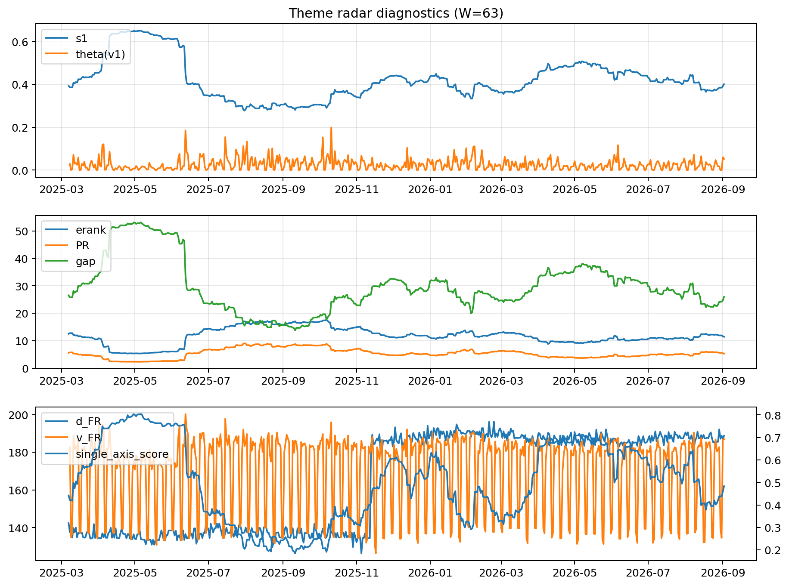

# Theme Radar Daily Brief — 2026-09-02

## Leaders (v1) — W=63
- **Nuclear_Uranium** (0.0893426245607435)
- Semis (0.0685634231879298)
- Quantum (0.0623859591346532)

## Challengers — W=63
**v2:** Rates (0.0839157131973295), Semis (0.0828355778885522), Genomics_Bio (0.0719910958941663)
**v3:** Crypto (0.0952046864061261), Metals (0.087565719452203), Genomics_Bio (0.0787856259566286)

## Migration (20D slope) — W=63
**Top risers:**
- axis_Space: 0.0004134448743999
- axis_Rates: 0.0002682579152781
- axis_Genomics_Bio: 0.0002493434996711
- axis_Commodities: 0.0002398026439606
- axis_Drones_Autonomy: 0.0001644151881307
- axis_DataCenter_Infra: 0.0001521216597546
- axis_Software_Cloud: 0.0001346632490689
- axis_Nuclear_Uranium: 6.2694286309184e-05
- axis_USD: 5.873675941578579e-05
- axis_Sector_Fin: 3.1488426851472294e-05

**Top fallers:**
- axis_Sector_ConsDisc: -7.130805386306507e-05
- axis_Sector_ConsStap: -7.278878413630453e-05
- axis_Robotics: -7.318983601888206e-05
- axis_Sector_RealEstate: -8.484105804614422e-05
- axis_Grid_Power: -9.891403149096166e-05
- axis_Critical_Minerals: -0.0001120829919402
- axis_MegaCap_AI: -0.0001737877363935
- axis_Sector_Health: -0.0002113005444104
- axis_Semis: -0.0002201189066096
- axis_Crypto: -0.0004080587259082

## Risk line (W=63)
- s1: 0.4007710214123524
- theta_v1: 0.0519429350221142
- v_FR: 186.939409161758
- single_axis_score: 0.4833027522935779

## Interpretation
**Regime:** `theme_migration`

- Action: Tomorrow watchlist: Space, Rates, Genomics_Bio, Commodities, Drones_Autonomy + v2_top1=Rates
- Action: Hedge note: normal correlation stability.

- Percentiles (W=63 history): vfr_pct=0.87, theta_pct=0.87, s1_pct=0.44, score_pct=0.46.

---
**BUNDLE_ROOT_SHA256:** `fecb0b6d346f2f0c62dee8fe462c40e13c514538a2e56ab875e6163520870d3d`
