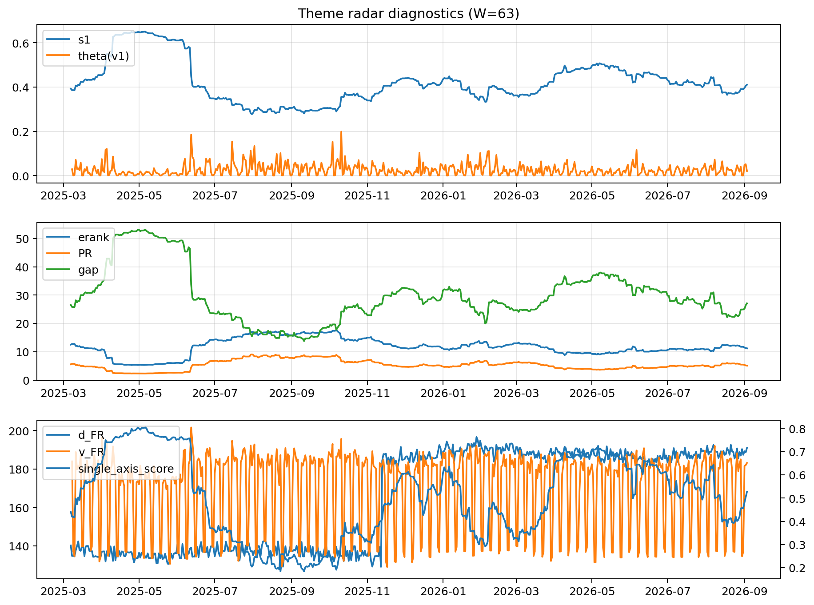

# Theme Radar Daily Brief — 2026-09-03

## Leaders (v1) — W=63
- **Nuclear_Uranium** (0.0894190483127222)
- Semis (0.0703414032286912)
- Quantum (0.0630812230208153)

## Challengers — W=63
**v2:** Rates (0.0929150685227755), Semis (0.0770301585199068), Genomics_Bio (0.0747735207727632)
**v3:** Crypto (0.0876986489833158), Genomics_Bio (0.0814069686611823), Metals (0.073377944197597)

## Migration (20D slope) — W=63
**Top risers:**
- axis_Rates: 0.0004426980430724
- axis_Space: 0.0003722113570275
- axis_Genomics_Bio: 0.0003196587428127
- axis_DataCenter_Infra: 0.0002629444416402
- axis_Commodities: 0.0002184247414877
- axis_Software_Cloud: 0.0001948448499134
- axis_Drones_Autonomy: 0.0001531006860248
- axis_USD: 6.876156523990377e-05
- axis_Cyber: 5.198131006288427e-05
- axis_Credit: 4.451155876779561e-05

**Top fallers:**
- axis_Sector_ConsDisc: -0.0001064782531471
- axis_Equity_ExUS: -0.0001081217954881
- axis_Robotics: -0.0001107749294976
- axis_Sector_RealEstate: -0.0001179917787393
- axis_Critical_Minerals: -0.000156246841312
- axis_Grid_Power: -0.0001573944572751
- axis_Crypto: -0.0001606998363346
- axis_MegaCap_AI: -0.000219659532611
- axis_Sector_Health: -0.0002224511016167
- axis_Semis: -0.0002581103844294

## Risk line (W=63)
- s1: 0.4101176953373769
- theta_v1: 0.020563651732099
- v_FR: 183.1686343280221
- single_axis_score: 0.5271062271062271

## Interpretation
**Regime:** `theme_migration`

- Action: Tomorrow watchlist: Rates, Space, Genomics_Bio, DataCenter_Infra, Commodities + v2_top1=Rates
- Action: Hedge note: normal correlation stability.

- Percentiles (W=63 history): vfr_pct=0.66, theta_pct=0.52, s1_pct=0.52, score_pct=0.53.

---
**BUNDLE_ROOT_SHA256:** `daf15be640a5d3c47053dc5e2e92181f34a2afec46527e828c48a461238d8159`
