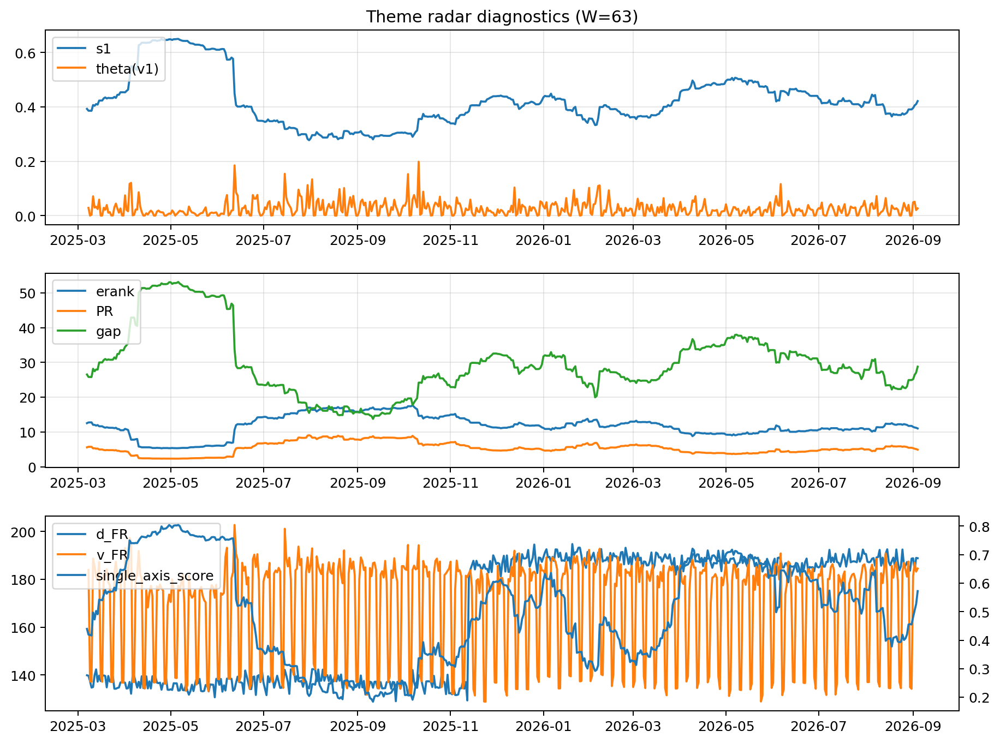

# Theme Radar Daily Brief — 2026-09-04

## Leaders (v1) — W=63
- **Nuclear_Uranium** (0.0882169002506583)
- Semis (0.0684152716536171)
- Quantum (0.0622470983085254)

## Challengers — W=63
**v2:** Rates (0.0977565338356034), Semis (0.0771789063118447), Grid_Power (0.0623073019925974)
**v3:** Genomics_Bio (0.0917255713588564), Crypto (0.0903901181464977), Metals (0.0760882410452871)

## Migration (20D slope) — W=63
**Top risers:**
- axis_Rates: 0.0005550786847875
- axis_Space: 0.0003639976681683
- axis_Genomics_Bio: 0.0003599102979559
- axis_DataCenter_Infra: 0.0002978313610075
- axis_Software_Cloud: 0.0002482130524941
- axis_Commodities: 0.0002415887403766
- axis_Drones_Autonomy: 0.000158006195336
- axis_Cyber: 6.460460645630298e-05
- axis_USD: 6.447082892722326e-05
- axis_Credit: 6.0546469252802095e-05

**Top fallers:**
- axis_Sector_ConsDisc: -0.000101069183631
- axis_Equity_US: -0.000115010617514
- axis_Equity_ExUS: -0.0001297777357222
- axis_Robotics: -0.0001322307288564
- axis_Sector_RealEstate: -0.0001505904343177
- axis_Critical_Minerals: -0.0001956393972569
- axis_MegaCap_AI: -0.0002073011888501
- axis_Grid_Power: -0.0002092408284333
- axis_Sector_Health: -0.0002236375002491
- axis_Semis: -0.0003262396204119

## Risk line (W=63)
- s1: 0.4212434064160149
- theta_v1: 0.0267059341991588
- v_FR: 184.52432965507347
- single_axis_score: 0.5722120658135283

## Interpretation
**Regime:** `theme_migration`

- Action: Tomorrow watchlist: Rates, Space, Genomics_Bio, DataCenter_Infra, Software_Cloud + v2_top1=Rates
- Action: Hedge note: normal correlation stability.

- Percentiles (W=63 history): vfr_pct=0.75, theta_pct=0.61, s1_pct=0.58, score_pct=0.62.

---
**BUNDLE_ROOT_SHA256:** `9d7d80c505d7e0a439186a73fdc53b705d90a53a102845bd6736e1db1770032b`
