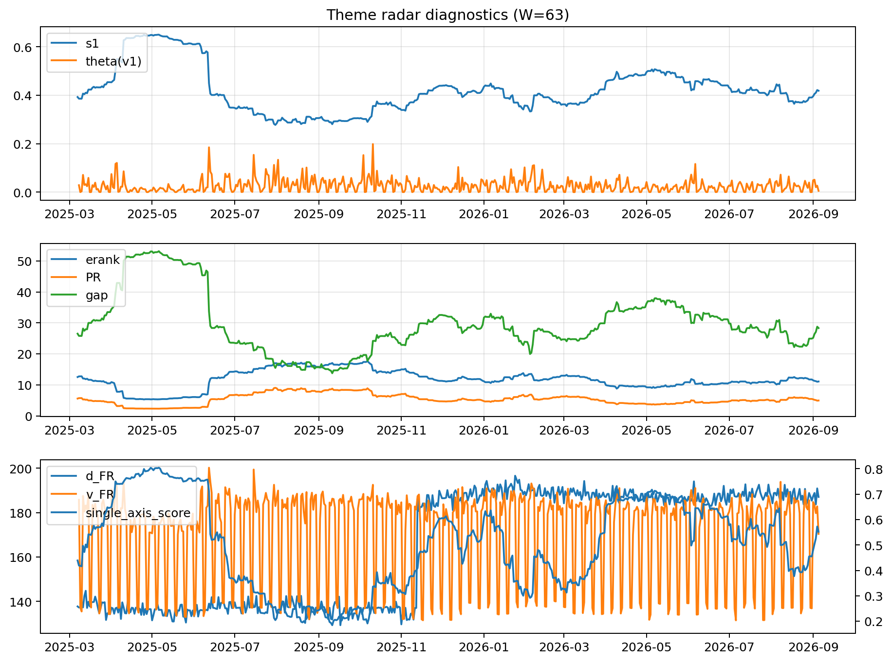

# Theme Radar Daily Brief — 2026-09-05

## Leaders (v1) — W=63
- **Nuclear_Uranium** (0.0884435699828966)
- Semis (0.0679321533270911)
- Quantum (0.0624529717894638)

## Challengers — W=63
**v2:** Rates (0.0931818510375425), Semis (0.0786407451891202), Grid_Power (0.0629135957004164)
**v3:** Genomics_Bio (0.0905712808283492), Crypto (0.0899007396172856), Metals (0.0761863381387061)

## Migration (20D slope) — W=63
**Top risers:**
- axis_Rates: 0.0006565531541448
- axis_Genomics_Bio: 0.0003983158343612
- axis_Space: 0.0003487762109697
- axis_DataCenter_Infra: 0.0003231661310887
- axis_Software_Cloud: 0.0002906101103157
- axis_Commodities: 0.0002609997156355
- axis_Drones_Autonomy: 0.0001578013496393
- axis_Metals: 7.829982201333528e-05
- axis_Cyber: 7.689189968313168e-05
- axis_Sector_Fin: 7.53816428383522e-05

**Top fallers:**
- axis_Nuclear_Uranium: -0.0001260781113402
- axis_Equity_US: -0.0001427053476257
- axis_Robotics: -0.0001490934989889
- axis_Equity_ExUS: -0.0001492344039815
- axis_Sector_RealEstate: -0.0001774321063668
- axis_MegaCap_AI: -0.0001902114258803
- axis_Sector_Health: -0.0002188379833438
- axis_Critical_Minerals: -0.0002286411084614
- axis_Grid_Power: -0.0002556655446044
- axis_Semis: -0.0003922002845585

## Risk line (W=63)
- s1: 0.4185194146518817
- theta_v1: 0.0054741265701265
- v_FR: 170.40656422402168
- single_axis_score: 0.5521897810218979

## Interpretation
**Regime:** `theme_migration`

- Action: Tomorrow watchlist: Rates, Genomics_Bio, Space, DataCenter_Infra, Software_Cloud + v2_top1=Rates
- Action: Hedge note: normal correlation stability.

- Percentiles (W=63 history): vfr_pct=0.29, theta_pct=0.28, s1_pct=0.56, score_pct=0.58.

---
**BUNDLE_ROOT_SHA256:** `6cb5c452fc40d1c50f54f1f8c684278402b750b6a13fa4f3e5abbedc92d63293`
