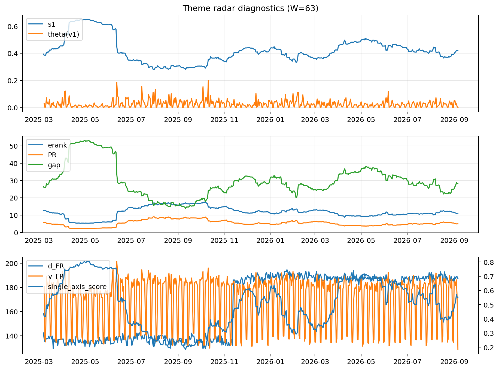

# Theme Radar Daily Brief — 2026-09-06

## Leaders (v1) — W=63
- **Nuclear_Uranium** (0.0884435089525409)
- Semis (0.067931915359482)
- Quantum (0.0624525389979722)

## Challengers — W=63
**v2:** Rates (0.093168255340313), Semis (0.0786336790402249), Grid_Power (0.0629135273005289)
**v3:** Genomics_Bio (0.0905224015569938), Crypto (0.0899400462699587), Metals (0.0761947168597265)

## Migration (20D slope) — W=63
**Top risers:**
- axis_Rates: 0.0007456879216744
- axis_Genomics_Bio: 0.0004320920883385
- axis_DataCenter_Infra: 0.0003380986605601
- axis_Software_Cloud: 0.000328681760165
- axis_Space: 0.0003226939690313
- axis_Commodities: 0.000275209971575
- axis_Crypto: 0.0001772456716016
- axis_Drones_Autonomy: 0.0001515309527806
- axis_Metals: 0.0001139742251837
- axis_Sector_Fin: 9.525095421784346e-05

**Top fallers:**
- axis_Robotics: -0.0001628709875982
- axis_Equity_ExUS: -0.0001660417038889
- axis_Equity_US: -0.0001670365294852
- axis_MegaCap_AI: -0.000167796122596
- axis_Nuclear_Uranium: -0.0001920984812742
- axis_Sector_RealEstate: -0.0001991296263266
- axis_Sector_Health: -0.0002084323027631
- axis_Critical_Minerals: -0.0002567618477787
- axis_Grid_Power: -0.0002969588800416
- axis_Semis: -0.000448651110253

## Risk line (W=63)
- s1: 0.4185196875239567
- theta_v1: 1.3326021061317625e-05
- v_FR: 128.62041999931714
- single_axis_score: 0.5522768670309655

## Interpretation
**Regime:** `theme_migration`

- Action: Tomorrow watchlist: Rates, Genomics_Bio, DataCenter_Infra, Software_Cloud, Space + v2_top1=Rates
- Action: Hedge note: normal correlation stability.

- Percentiles (W=63 history): vfr_pct=0.00, theta_pct=0.00, s1_pct=0.56, score_pct=0.58.

---
**BUNDLE_ROOT_SHA256:** `aa0fe33ec46ffebbae6a811652bad3e64fd03808deaf475a959a78a15ca84d22`
