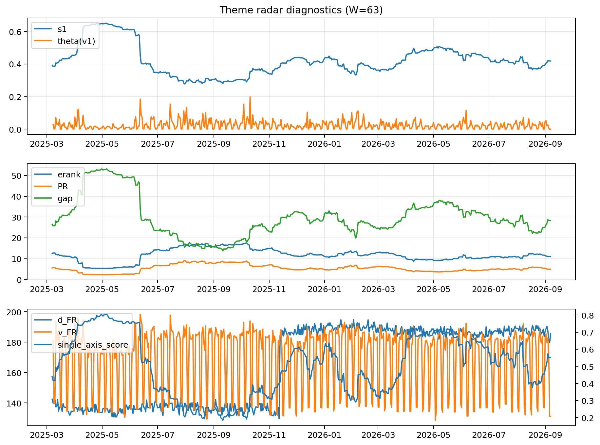

# Theme Radar Daily Brief — 2026-09-07

## Leaders (v1) — W=63
- **Nuclear_Uranium** (0.0884434424083388)
- Semis (0.0679319413057957)
- Quantum (0.0624526895997273)

## Challengers — W=63
**v2:** Rates (0.0931800608587101), Semis (0.0786401952293423), Grid_Power (0.0629144934132518)
**v3:** Genomics_Bio (0.0905559158516532), Crypto (0.0899144894556835), Metals (0.0761897299350765)

## Migration (20D slope) — W=63
**Top risers:**
- axis_Rates: 0.000811056718476
- axis_Genomics_Bio: 0.0004207821434415
- axis_DataCenter_Infra: 0.000344116850215
- axis_Software_Cloud: 0.0003392223453412
- axis_Space: 0.0003273768312399
- axis_Commodities: 0.000266251470209
- axis_Crypto: 0.000253372472604
- axis_Drones_Autonomy: 0.0001557852945419
- axis_Metals: 0.0001134698155744
- axis_Sector_Fin: 0.000105145168223

**Top fallers:**
- axis_MegaCap_AI: -0.0001537928050757
- axis_Robotics: -0.0001643501940372
- axis_Equity_ExUS: -0.0001710100504989
- axis_Equity_US: -0.0001805943719421
- axis_Sector_Health: -0.0001908032515589
- axis_Sector_RealEstate: -0.0002168117357256
- axis_Nuclear_Uranium: -0.0002393778159646
- axis_Critical_Minerals: -0.000271265970253
- axis_Grid_Power: -0.0003165065748036
- axis_Semis: -0.0004725403845884

## Risk line (W=63)
- s1: 0.4185200425745325
- theta_v1: 8.437992225207271e-06
- v_FR: 131.0693697547351
- single_axis_score: 0.5523636363636364

## Interpretation
**Regime:** `theme_migration`

- Action: Tomorrow watchlist: Rates, Genomics_Bio, DataCenter_Infra, Software_Cloud, Space + v2_top1=Rates
- Action: Hedge note: normal correlation stability.

- Percentiles (W=63 history): vfr_pct=0.01, theta_pct=0.00, s1_pct=0.56, score_pct=0.58.

---
**BUNDLE_ROOT_SHA256:** `467ad0a1313f4430367e017a63daf0885bca8ce6a3ce18816594a460ea58b98c`
