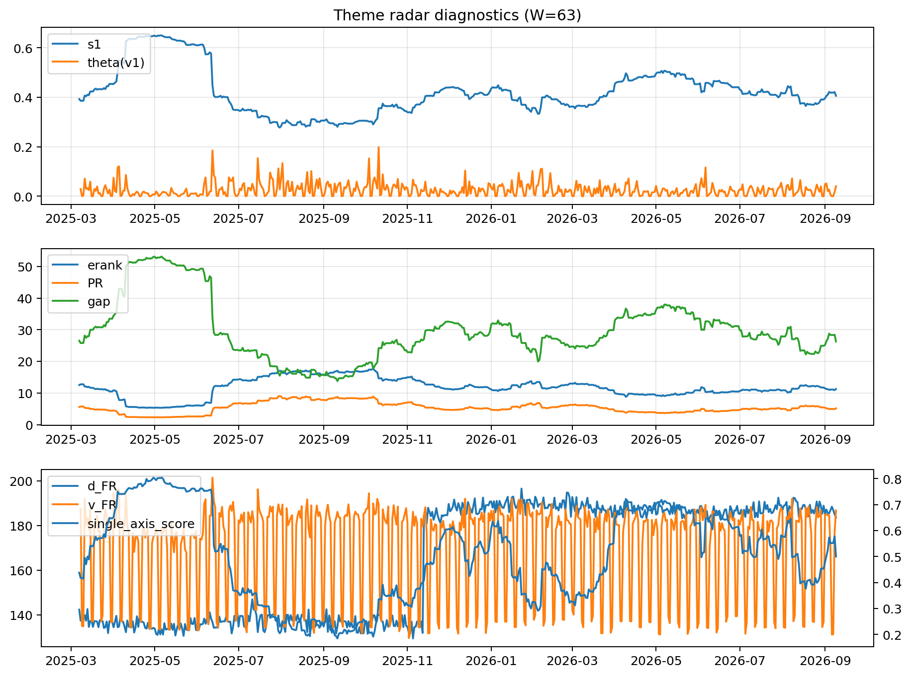

# Theme Radar Daily Brief — 2026-09-09

## Leaders (v1) — W=63
- **Nuclear_Uranium** (0.0880489878004155)
- Semis (0.0681692596865077)
- Quantum (0.0635462317218326)

## Challengers — W=63
**v2:** Rates (0.092518055061266), Semis (0.078830123668317), Grid_Power (0.0601781265584734)
**v3:** Crypto (0.0900191141071818), Genomics_Bio (0.086057247627937), Metals (0.0761383538697374)

## Migration (20D slope) — W=63
**Top risers:**
- axis_Rates: 0.000793603261823
- axis_DataCenter_Infra: 0.0004527390968907
- axis_Genomics_Bio: 0.0003978956148476
- axis_Crypto: 0.000342859114977
- axis_Space: 0.0003428329360057
- axis_Software_Cloud: 0.0003005568414306
- axis_Commodities: 0.0002420466699537
- axis_Drones_Autonomy: 0.0001736836771485
- axis_Metals: 0.0001531998998932
- axis_Sector_Fin: 0.000100616122704

**Top fallers:**
- axis_Sector_Health: -0.0001507612911594
- axis_Robotics: -0.0001537113016013
- axis_Sector_Utilities: -0.0001599578269261
- axis_Equity_ExUS: -0.0001646497067353
- axis_Equity_US: -0.0001933910437297
- axis_Sector_RealEstate: -0.0002634056714
- axis_Critical_Minerals: -0.0002764440172211
- axis_Nuclear_Uranium: -0.0002865534399953
- axis_Grid_Power: -0.000320614469874
- axis_Semis: -0.0004768224363805

## Risk line (W=63)
- s1: 0.4058022598111569
- theta_v1: 0.0400646471307494
- v_FR: 186.7564664843119
- single_axis_score: 0.5

## Interpretation
**Regime:** `theme_migration`

- Action: Tomorrow watchlist: Rates, DataCenter_Infra, Genomics_Bio, Crypto, Space + v2_top1=Rates
- Action: Hedge note: normal correlation stability.

- Percentiles (W=63 history): vfr_pct=0.87, theta_pct=0.79, s1_pct=0.47, score_pct=0.48.

---
**BUNDLE_ROOT_SHA256:** `14e604e56dae3639dca9765f073a2ae01f669f8b5d4ce0b1f9f518122869141e`
