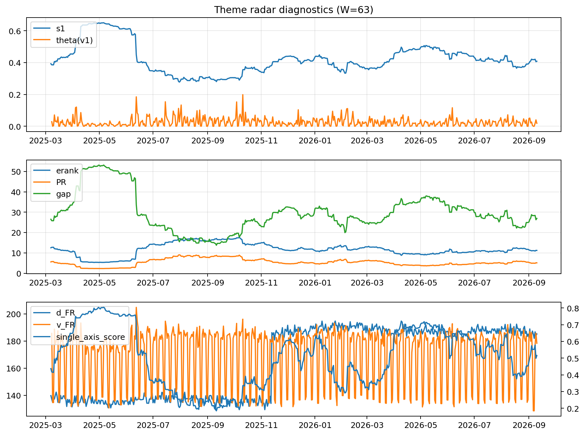

# Theme Radar Daily Brief — 2026-09-10

## Leaders (v1) — W=63
- **Nuclear_Uranium** (0.088118272102908)
- Semis (0.0696654613476476)
- Quantum (0.0637636286549253)

## Challengers — W=63
**v2:** Rates (0.0983121971669268), Semis (0.0752768853274892), Grid_Power (0.0597489172782777)
**v3:** Crypto (0.0922059484583521), Metals (0.0871084345346648), Genomics_Bio (0.081211427910019)

## Migration (20D slope) — W=63
**Top risers:**
- axis_Rates: 0.0007349672098353
- axis_DataCenter_Infra: 0.0005064406401717
- axis_Genomics_Bio: 0.0003824675578132
- axis_Space: 0.000354238554093
- axis_Crypto: 0.0003424762704913
- axis_Software_Cloud: 0.0002832365549968
- axis_Commodities: 0.0002222944516131
- axis_Drones_Autonomy: 0.0001831046037145
- axis_Metals: 0.0001507205573023
- axis_Sector_Fin: 0.0001018962638001

**Top fallers:**
- axis_Sector_Health: -0.0001452113521162
- axis_Quantum: -0.0001527791766384
- axis_Equity_ExUS: -0.0001572473385242
- axis_Sector_Utilities: -0.000187032299819
- axis_Equity_US: -0.0001877735503816
- axis_Critical_Minerals: -0.0002698382997246
- axis_Sector_RealEstate: -0.0002767610705327
- axis_Nuclear_Uranium: -0.0002936499498649
- axis_Grid_Power: -0.0003047626210325
- axis_Semis: -0.0004489371036927

## Risk line (W=63)
- s1: 0.4082657103236222
- theta_v1: 0.0185871095129982
- v_FR: 178.36908367049074
- single_axis_score: 0.5157323688969259

## Interpretation
**Regime:** `theme_migration`

- Action: Tomorrow watchlist: Rates, DataCenter_Infra, Genomics_Bio, Space, Crypto + v2_top1=Rates
- Action: Hedge note: normal correlation stability.

- Percentiles (W=63 history): vfr_pct=0.41, theta_pct=0.48, s1_pct=0.49, score_pct=0.50.

---
**BUNDLE_ROOT_SHA256:** `79b3cabe1c4d61e7a10224a13e49086ada3bb3f7fe62131f29574047abdb1c25`
