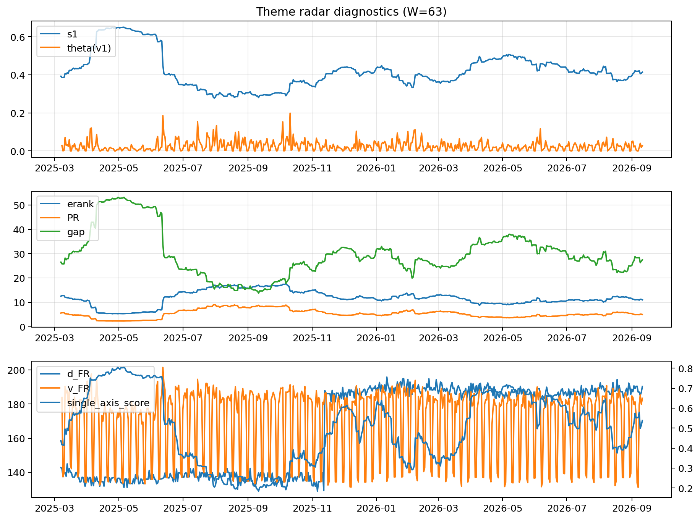

# Theme Radar Daily Brief — 2026-09-11

## Leaders (v1) — W=63
- **Nuclear_Uranium** (0.0880299291504757)
- Semis (0.0690823758214484)
- Quantum (0.06283383196141)

## Challengers — W=63
**v2:** Rates (0.0953957787626385), Semis (0.0755712424828835), Grid_Power (0.0597372580452463)
**v3:** Crypto (0.0843832892734796), Metals (0.0820271631141943), Genomics_Bio (0.0727103360538015)

## Migration (20D slope) — W=63
**Top risers:**
- axis_Rates: 0.0006741334386362
- axis_DataCenter_Infra: 0.0005372032090524
- axis_Genomics_Bio: 0.0004036500259067
- axis_Crypto: 0.000372924243098
- axis_Space: 0.0003409541975824
- axis_Software_Cloud: 0.0002613571359991
- axis_Commodities: 0.0002040177453322
- axis_Drones_Autonomy: 0.000183184193503
- axis_Metals: 0.0001704902823474
- axis_Sector_Fin: 0.000106183044911

**Top fallers:**
- axis_Equity_ExUS: -0.0001465862877564
- axis_Sector_Health: -0.0001494943770568
- axis_Quantum: -0.0001678060589558
- axis_Equity_US: -0.00018027275453
- axis_Sector_Utilities: -0.0002007269528517
- axis_Critical_Minerals: -0.000255899578138
- axis_Sector_RealEstate: -0.0002930841683443
- axis_Grid_Power: -0.0002993136265369
- axis_Nuclear_Uranium: -0.0003106905588933
- axis_Semis: -0.0004274531366429

## Risk line (W=63)
- s1: 0.4137448001265267
- theta_v1: 0.0282761255509429
- v_FR: 183.37409391775583
- single_axis_score: 0.5379061371841155

## Interpretation
**Regime:** `theme_migration`

- Action: Tomorrow watchlist: Rates, DataCenter_Infra, Genomics_Bio, Crypto, Space + v2_top1=Rates
- Action: Hedge note: normal correlation stability.

- Percentiles (W=63 history): vfr_pct=0.65, theta_pct=0.64, s1_pct=0.53, score_pct=0.55.

---
**BUNDLE_ROOT_SHA256:** `b027765b5464835b53625397aab5a026951ec335ad0a65cb5f861dd915e503c2`
