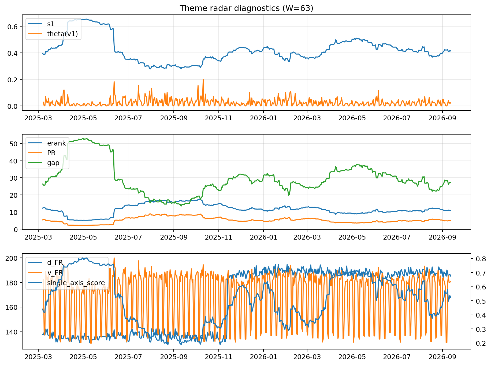

# Theme Radar Daily Brief — 2026-09-12

## Leaders (v1) — W=63
- **Nuclear_Uranium** (0.0849784615748)
- Semis (0.0697357741680112)
- Quantum (0.0635338951769651)

## Challengers — W=63
**v2:** Rates (0.0963988434607249), Semis (0.0776814470385463), Genomics_Bio (0.059516856967205)
**v3:** Genomics_Bio (0.0874170716121518), Metals (0.08037992022015), Nuclear_Uranium (0.0645222041896593)

## Migration (20D slope) — W=63
**Top risers:**
- axis_Rates: 0.0005902777074047
- axis_DataCenter_Infra: 0.0005681452579648
- axis_Genomics_Bio: 0.0004405269416884
- axis_Space: 0.0003332657714767
- axis_Crypto: 0.0003074059274755
- axis_Software_Cloud: 0.0002359516275426
- axis_Metals: 0.0002032855835106
- axis_Commodities: 0.0001880173188325
- axis_Drones_Autonomy: 0.0001843853180829
- axis_Sector_Fin: 0.000114545772945

**Top fallers:**
- axis_Sector_ConsStap: -0.0001310852506399
- axis_Sector_Health: -0.0001494617113014
- axis_Equity_US: -0.0001642803614851
- axis_Quantum: -0.0001711520138639
- axis_Sector_Utilities: -0.000208926114939
- axis_Critical_Minerals: -0.0002365051982614
- axis_Grid_Power: -0.000289639394272
- axis_Sector_RealEstate: -0.0003074972431793
- axis_Nuclear_Uranium: -0.00036318316479
- axis_Semis: -0.0003960623738315

## Risk line (W=63)
- s1: 0.4148484821691392
- theta_v1: 0.0217923129783979
- v_FR: 180.56650711824827
- single_axis_score: 0.5239639639639639

## Interpretation
**Regime:** `theme_migration`

- Action: Tomorrow watchlist: Rates, DataCenter_Infra, Genomics_Bio, Space, Crypto + v2_top1=Rates
- Action: Hedge note: normal correlation stability.

- Percentiles (W=63 history): vfr_pct=0.51, theta_pct=0.55, s1_pct=0.53, score_pct=0.51.

---
**BUNDLE_ROOT_SHA256:** `c11f51e6ad1c09b7fc08b269d9968cfd678e69dcfe1b5e23c67978856587d831`
