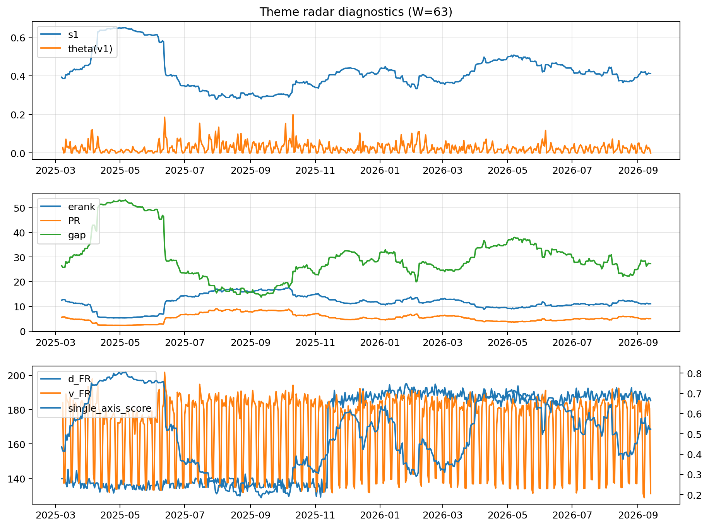

# Theme Radar Daily Brief — 2026-09-13

## Leaders (v1) — W=63
- **Nuclear_Uranium** (0.0844318883746875)
- Semis (0.0691209701728761)
- Quantum (0.0629578920880626)

## Challengers — W=63
**v2:** Rates (0.093561889692972), Semis (0.0760187600575148), Genomics_Bio (0.0607743081431141)
**v3:** Crypto (0.0792593006157137), Genomics_Bio (0.0768465637286423), Metals (0.0765966142326331)

## Migration (20D slope) — W=63
**Top risers:**
- axis_DataCenter_Infra: 0.0005689918629259
- axis_Rates: 0.000475784588919
- axis_Genomics_Bio: 0.0004349427586064
- axis_Crypto: 0.0004265052437359
- axis_Space: 0.0002928080794726
- axis_Metals: 0.0002219181178036
- axis_Software_Cloud: 0.0002031475406075
- axis_Drones_Autonomy: 0.0001679493180133
- axis_Commodities: 0.0001556717205925
- axis_MegaCap_AI: 0.0001351041674339

**Top fallers:**
- axis_Sector_ConsStap: -0.0001343425505312
- axis_Sector_Health: -0.0001426863857827
- axis_Equity_US: -0.0001477551186922
- axis_Quantum: -0.0001868650428025
- axis_Sector_Utilities: -0.0002100956990638
- axis_Critical_Minerals: -0.0002126274290842
- axis_Grid_Power: -0.0002742627580004
- axis_Sector_RealEstate: -0.0003091806247219
- axis_Semis: -0.0003566839064614
- axis_Nuclear_Uranium: -0.0004237680166328

## Risk line (W=63)
- s1: 0.4118701579924629
- theta_v1: 0.0001308816271734
- v_FR: 131.15022701641595
- single_axis_score: 0.5233812949640289

## Interpretation
**Regime:** `theme_migration`

- Action: Tomorrow watchlist: DataCenter_Infra, Rates, Genomics_Bio, Crypto, Space + v2_top1=Rates
- Action: Hedge note: normal correlation stability.

- Percentiles (W=63 history): vfr_pct=0.01, theta_pct=0.08, s1_pct=0.53, score_pct=0.52.

---
**BUNDLE_ROOT_SHA256:** `99509ac92fa151e35d3b028b382fab5ec3d9e9ba56f1b2bf8343f8560a336afd`
