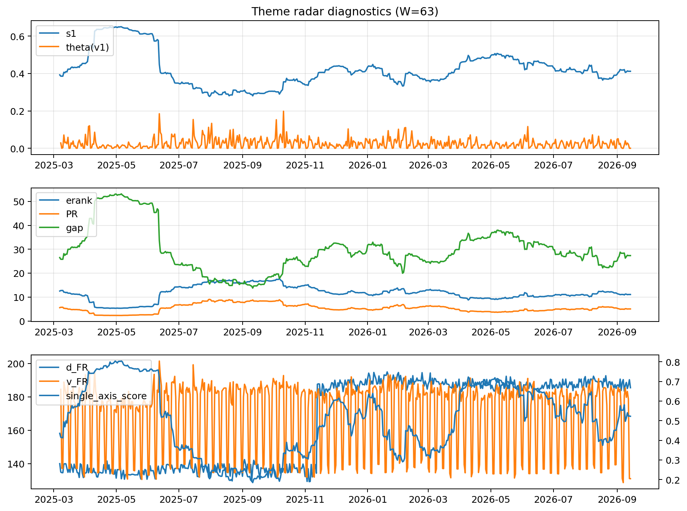

# Theme Radar Daily Brief — 2026-09-14

## Leaders (v1) — W=63
- **Nuclear_Uranium** (0.0844355715734213)
- Semis (0.0691262823978761)
- Quantum (0.0629628423399511)

## Challengers — W=63
**v2:** Rates (0.093565832402406), Semis (0.0760267405677865), Genomics_Bio (0.0607431699211049)
**v3:** Crypto (0.0792875423717644), Genomics_Bio (0.0768574022522179), Metals (0.0766550337767993)

## Migration (20D slope) — W=63
**Top risers:**
- axis_DataCenter_Infra: 0.0005779197062054
- axis_Genomics_Bio: 0.0004389707603812
- axis_Crypto: 0.0004309903599936
- axis_Rates: 0.0003265239162105
- axis_Space: 0.0002724297006606
- axis_Metals: 0.000233623991026
- axis_MegaCap_AI: 0.0001843688836053
- axis_Software_Cloud: 0.0001709191587458
- axis_Drones_Autonomy: 0.000167190604473
- axis_Sector_Fin: 0.0001097553274903

**Top fallers:**
- axis_Equity_US: -0.000125861732366
- axis_Sector_ConsStap: -0.0001293077272879
- axis_Sector_Health: -0.0001339011198594
- axis_Critical_Minerals: -0.0001876364418113
- axis_Quantum: -0.000194003504581
- axis_Sector_Utilities: -0.0002007501166226
- axis_Grid_Power: -0.000232322323439
- axis_Semis: -0.000298320997554
- axis_Sector_RealEstate: -0.0003007556874054
- axis_Nuclear_Uranium: -0.0004677004705187

## Risk line (W=63)
- s1: 0.41185206201297
- theta_v1: 0.0003711844414429
- v_FR: 131.0349710815804
- single_axis_score: 0.5224416517055654

## Interpretation
**Regime:** `theme_migration`

- Action: Tomorrow watchlist: DataCenter_Infra, Genomics_Bio, Crypto, Rates, Space + v2_top1=Rates
- Action: Hedge note: normal correlation stability.

- Percentiles (W=63 history): vfr_pct=0.01, theta_pct=0.14, s1_pct=0.52, score_pct=0.51.

---
**BUNDLE_ROOT_SHA256:** `1a9dde24beed0f867c419a8b2b48aa7b9ac89f3a97e61475734996170c130b5a`
