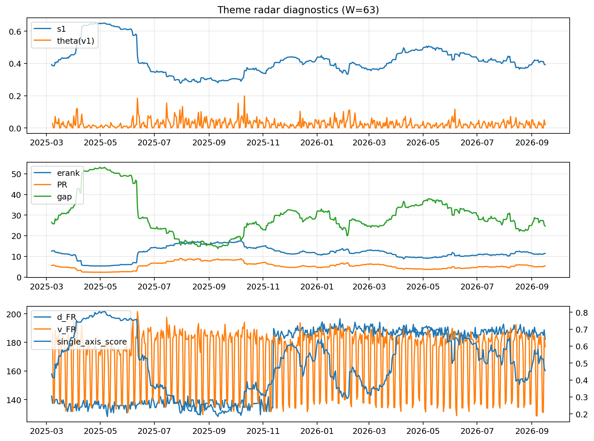

# Theme Radar Daily Brief — 2026-09-16

## Leaders (v1) — W=63
- **Nuclear_Uranium** (0.0853865459557179)
- Semis (0.0705402286527217)
- Quantum (0.0637594432040636)

## Challengers — W=63
**v2:** Rates (0.0908758629110453), Semis (0.0796387196819894), Genomics_Bio (0.0683256619444913)
**v3:** Metals (0.0826935239450427), Genomics_Bio (0.0745590112426354), Crypto (0.0740747673949743)

## Migration (20D slope) — W=63
**Top risers:**
- axis_DataCenter_Infra: 0.000625394271238
- axis_Genomics_Bio: 0.0003913824751298
- axis_MegaCap_AI: 0.0002857653208006
- axis_Space: 0.0002478485908751
- axis_Crypto: 0.0002307508961644
- axis_Metals: 0.0001723523362842
- axis_Drones_Autonomy: 0.0001366131196105
- axis_Sector_Fin: 0.0001312134137798
- axis_Rates: 0.0001090885646588
- axis_Sector_Materials: 9.500669230957264e-05

**Top fallers:**
- axis_Quantum: -0.0001212261480285
- axis_Sector_ConsStap: -0.0001230648125898
- axis_Grid_Power: -0.0001403402894562
- axis_Sector_Utilities: -0.00014617367883
- axis_Critical_Minerals: -0.0001494923202807
- axis_Sector_Energy: -0.0001679307595514
- axis_Semis: -0.000178652509361
- axis_Cyber: -0.0002116360512572
- axis_Sector_RealEstate: -0.0003135040164221
- axis_Nuclear_Uranium: -0.0004365500754884

## Risk line (W=63)
- s1: 0.3919813325422209
- theta_v1: 0.0206058198683455
- v_FR: 176.9554404142214
- single_axis_score: 0.4550983899821109

## Interpretation
**Regime:** `theme_migration`

- Action: Tomorrow watchlist: DataCenter_Infra, Genomics_Bio, MegaCap_AI, Space, Crypto + v2_top1=Rates
- Action: Hedge note: normal correlation stability.

- Percentiles (W=63 history): vfr_pct=0.37, theta_pct=0.52, s1_pct=0.39, score_pct=0.42.

---
**BUNDLE_ROOT_SHA256:** `d2d2543ccceba285d0c54b80bdd320d1e549c4b91c45fdee9dc81ff51e4e8dff`
