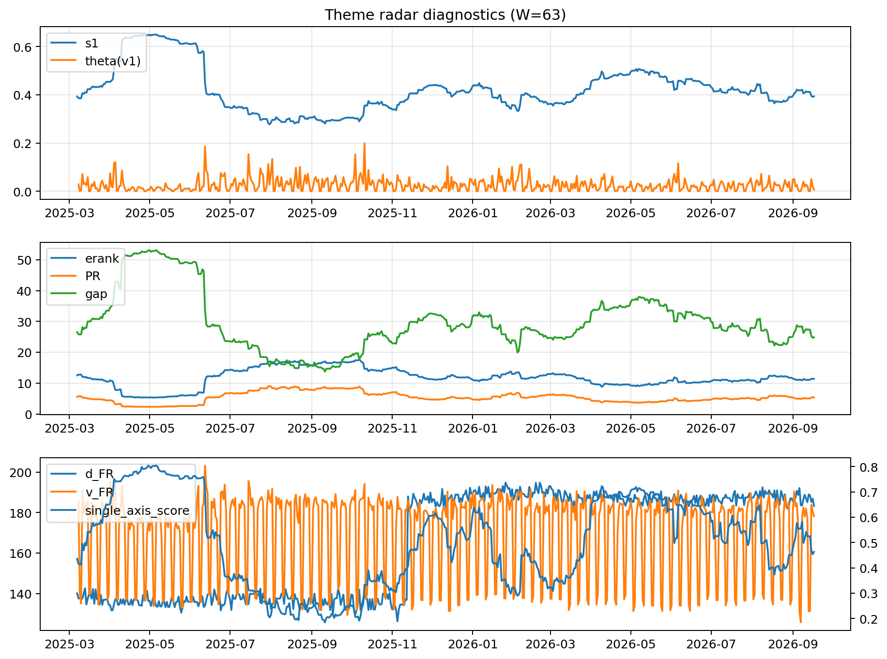

# Theme Radar Daily Brief — 2026-09-17

## Leaders (v1) — W=63
- **Nuclear_Uranium** (0.0853767930620924)
- Semis (0.0706524693880537)
- Quantum (0.0640538586953469)

## Challengers — W=63
**v2:** Rates (0.0888150591751788), Semis (0.0813938954276462), Genomics_Bio (0.0690409456028907)
**v3:** Metals (0.0830129780005373), Crypto (0.0720865646332958), Genomics_Bio (0.0713578211912007)

## Migration (20D slope) — W=63
**Top risers:**
- axis_DataCenter_Infra: 0.000622970787897
- axis_Genomics_Bio: 0.0003708604446998
- axis_MegaCap_AI: 0.0003267756459597
- axis_Space: 0.0002204344652195
- axis_Metals: 0.0001356982661677
- axis_Sector_Fin: 0.0001279830943471
- axis_Crypto: 0.0001254105040102
- axis_Drones_Autonomy: 0.0001161007798797
- axis_Sector_Materials: 8.753986747749128e-05
- axis_Commodities: 4.19744455886086e-05

**Top fallers:**
- axis_Grid_Power: -9.175587702776734e-05
- axis_Semis: -0.0001059371014544
- axis_Sector_Utilities: -0.0001128272490708
- axis_Sector_Health: -0.0001129407937138
- axis_Sector_ConsStap: -0.0001188360375891
- axis_Critical_Minerals: -0.0001229636165985
- axis_Sector_Energy: -0.00019265551952
- axis_Cyber: -0.0002817483694864
- axis_Sector_RealEstate: -0.0003064288885875
- axis_Nuclear_Uranium: -0.0004110415919031

## Risk line (W=63)
- s1: 0.3931776635664132
- theta_v1: 0.0064963003548313
- v_FR: 178.1871512649128
- single_axis_score: 0.4628571428571429

## Interpretation
**Regime:** `theme_migration`

- Action: Tomorrow watchlist: DataCenter_Infra, Genomics_Bio, MegaCap_AI, Space, Metals + v2_top1=Rates
- Action: Hedge note: normal correlation stability.

- Percentiles (W=63 history): vfr_pct=0.39, theta_pct=0.30, s1_pct=0.40, score_pct=0.42.

---
**BUNDLE_ROOT_SHA256:** `e2ad5ece7e5186d4004aaec316cefee8fcacd98dd051752e13ee2c62e8c76d79`
