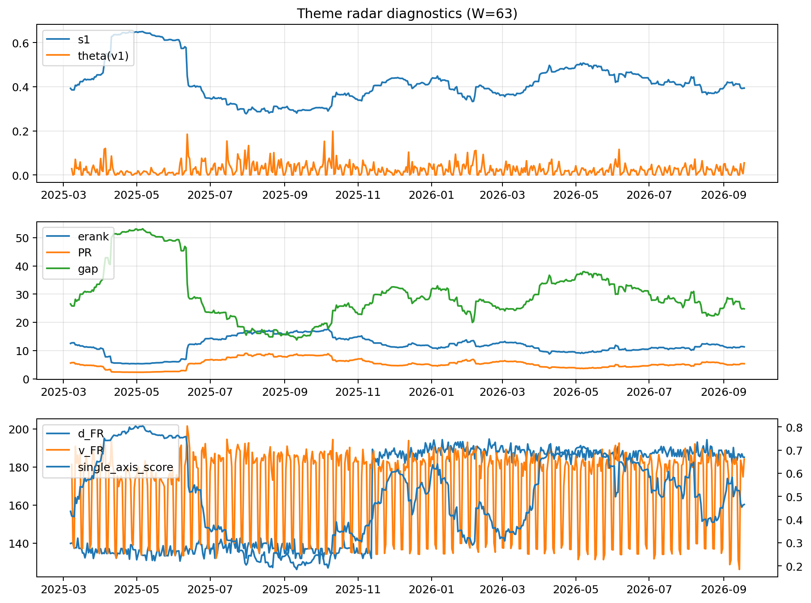

# Theme Radar Daily Brief — 2026-09-18

## Leaders (v1) — W=63
- **Nuclear_Uranium** (0.0844200719991719)
- Semis (0.0698280056382629)
- Quantum (0.0638369964312046)

## Challengers — W=63
**v2:** Rates (0.0842019816089879), Semis (0.0811283076088506), Genomics_Bio (0.0752072247267278)
**v3:** Metals (0.0787402177638084), Crypto (0.0639808093720507), Software_Cloud (0.0636284933168725)

## Migration (20D slope) — W=63
**Top risers:**
- axis_DataCenter_Infra: 0.0006245478299109
- axis_Genomics_Bio: 0.0003740327278043
- axis_MegaCap_AI: 0.0003185028715769
- axis_Space: 0.0001716585677877
- axis_Sector_Fin: 0.0001235860272588
- axis_Drones_Autonomy: 0.0001090252533287
- axis_Sector_Materials: 9.129553060962018e-05
- axis_Metals: 6.803514609793145e-05
- axis_Commodities: 4.9264639529817126e-05
- axis_Credit: 4.201975873534932e-05

**Top fallers:**
- axis_Semis: -5.886807316406576e-05
- axis_Sector_Utilities: -7.143554616652835e-05
- axis_Defense: -7.401567491429466e-05
- axis_Critical_Minerals: -0.0001131732168967
- axis_Sector_Health: -0.0001353856454699
- axis_Sector_ConsStap: -0.0001421803289876
- axis_Sector_Energy: -0.000219675535297
- axis_Sector_RealEstate: -0.0003018158775033
- axis_Cyber: -0.0003248059958398
- axis_Nuclear_Uranium: -0.0004106319562411

## Risk line (W=63)
- s1: 0.393622665269457
- theta_v1: 0.0550401129187121
- v_FR: 184.1092036864937
- single_axis_score: 0.4652406417112299

## Interpretation
**Regime:** `theme_migration`

- Action: Tomorrow watchlist: DataCenter_Infra, Genomics_Bio, MegaCap_AI, Space, Sector_Fin + v2_top1=Rates
- Action: Hedge note: normal correlation stability.

- Percentiles (W=63 history): vfr_pct=0.72, theta_pct=0.89, s1_pct=0.40, score_pct=0.43.

---
**BUNDLE_ROOT_SHA256:** `2f3977e723b2cb29e146e90ee75730238db327f75250853a5fe69ce02518a70e`
