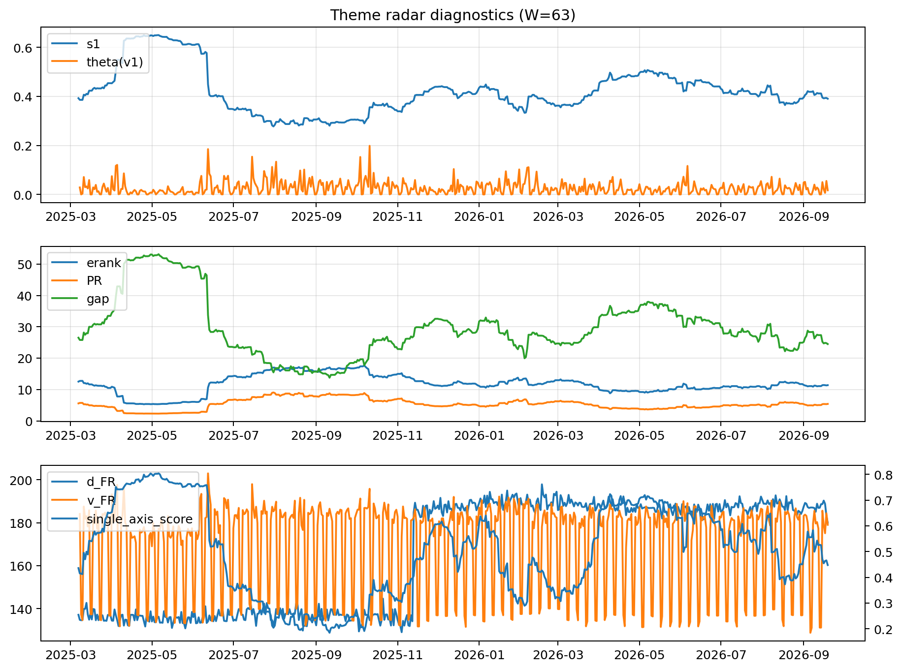

# Theme Radar Daily Brief — 2026-09-19

## Leaders (v1) — W=63
- **Nuclear_Uranium** (0.0843705253015992)
- Semis (0.0691428054170357)
- Quantum (0.0642093632963095)

## Challengers — W=63
**v2:** Rates (0.0899276926343617), Semis (0.0861132216134337), Genomics_Bio (0.0760020601253677)
**v3:** Metals (0.0841088113137685), Crypto (0.0712391330844263), Genomics_Bio (0.065718951035131)

## Migration (20D slope) — W=63
**Top risers:**
- axis_DataCenter_Infra: 0.000615959051564
- axis_Genomics_Bio: 0.000374408813845
- axis_MegaCap_AI: 0.0002983589545542
- axis_Space: 0.0001222993675116
- axis_Sector_Fin: 0.0001114525615974
- axis_Drones_Autonomy: 9.833303186998808e-05
- axis_Sector_Materials: 8.82595266295352e-05
- axis_Equity_US: 7.166116020287644e-05
- axis_Robotics: 5.4299475423975344e-05
- axis_Credit: 5.424800522634551e-05

**Top fallers:**
- axis_Software_Cloud: -7.234837085257407e-05
- axis_Defense: -8.427038315631095e-05
- axis_Crypto: -8.769480848010553e-05
- axis_Critical_Minerals: -9.834123737727077e-05
- axis_Sector_Health: -0.0001502120493711
- axis_Sector_ConsStap: -0.0001563994311923
- axis_Sector_Energy: -0.0002430282214453
- axis_Sector_RealEstate: -0.000288375548871
- axis_Cyber: -0.0003550322082593
- axis_Nuclear_Uranium: -0.0004001848012794

## Risk line (W=63)
- s1: 0.3904156810791127
- theta_v1: 0.016913782284604
- v_FR: 179.02491206644603
- single_axis_score: 0.4476868327402135

## Interpretation
**Regime:** `theme_migration`

- Action: Tomorrow watchlist: DataCenter_Infra, Genomics_Bio, MegaCap_AI, Space, Sector_Fin + v2_top1=Rates
- Action: Hedge note: normal correlation stability.

- Percentiles (W=63 history): vfr_pct=0.42, theta_pct=0.44, s1_pct=0.38, score_pct=0.40.

---
**BUNDLE_ROOT_SHA256:** `73fe2bc79f4ef2227186a5e24fcac4f2392225c1be8b8411abe311a263991064`
