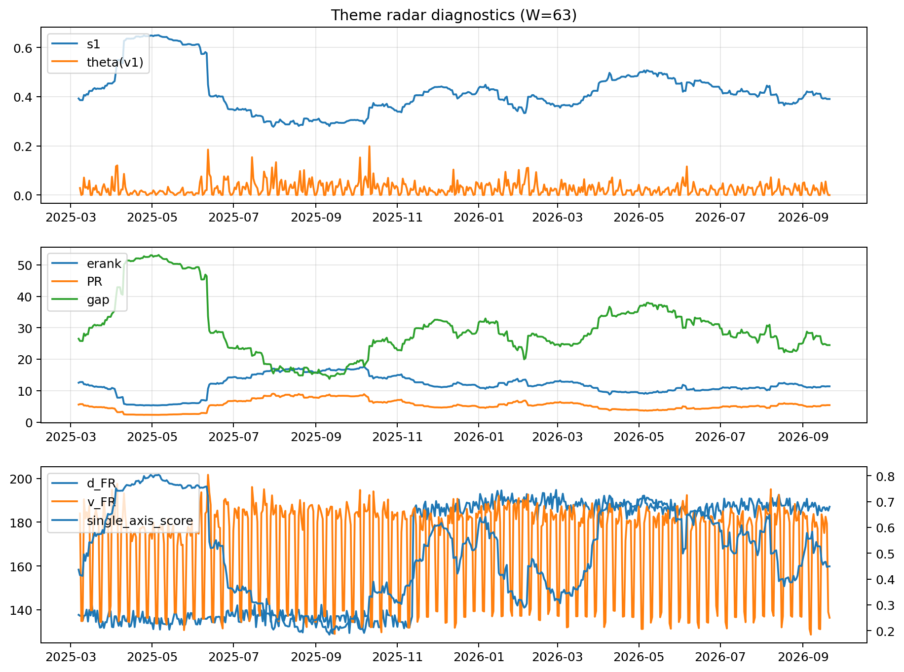

# Theme Radar Daily Brief — 2026-09-21

## Leaders (v1) — W=63
- **Nuclear_Uranium** (0.084369395124881)
- Semis (0.069141489910742)
- Quantum (0.0642081621970611)

## Challengers — W=63
**v2:** Rates (0.0899068250339465), Semis (0.0861035523683105), Genomics_Bio (0.0760062591350897)
**v3:** Metals (0.0841293631259753), Crypto (0.0713645313723901), Genomics_Bio (0.0656935642717184)

## Migration (20D slope) — W=63
**Top risers:**
- axis_DataCenter_Infra: 0.0005558068369868
- axis_Genomics_Bio: 0.0003477886150235
- axis_MegaCap_AI: 0.0002270214379116
- axis_Equity_US: 0.0001494441007991
- axis_Robotics: 0.0001048879028198
- axis_Sector_Materials: 8.517075083291965e-05
- axis_Space: 8.431612054911172e-05
- axis_Quantum: 8.001120967760017e-05
- axis_Sector_Fin: 7.21988903390381e-05
- axis_Drones_Autonomy: 7.090082606086338e-05

**Top fallers:**
- axis_Defense: -9.938329614556796e-05
- axis_Metals: -0.0001178032947184
- axis_Software_Cloud: -0.0001266248757635
- axis_Sector_Health: -0.0001628439667457
- axis_Sector_ConsStap: -0.0001695191448786
- axis_Sector_RealEstate: -0.0002431296342301
- axis_Sector_Energy: -0.0002740569841704
- axis_Nuclear_Uranium: -0.000319393166659
- axis_Crypto: -0.000346699616003
- axis_Cyber: -0.0004044776110746

## Risk line (W=63)
- s1: 0.3904194956175167
- theta_v1: 3.6387219936523454e-06
- v_FR: 136.35306803166478
- single_axis_score: 0.449290780141844

## Interpretation
**Regime:** `theme_migration`

- Action: Tomorrow watchlist: DataCenter_Infra, Genomics_Bio, MegaCap_AI, Equity_US, Robotics + v2_top1=Rates
- Action: Hedge note: normal correlation stability.

- Percentiles (W=63 history): vfr_pct=0.13, theta_pct=0.00, s1_pct=0.38, score_pct=0.40.

---
**BUNDLE_ROOT_SHA256:** `35abd0ed10575042d791e163d5e2fd36a67ebbad0b96f0741cb5ff9fc1f843de`
