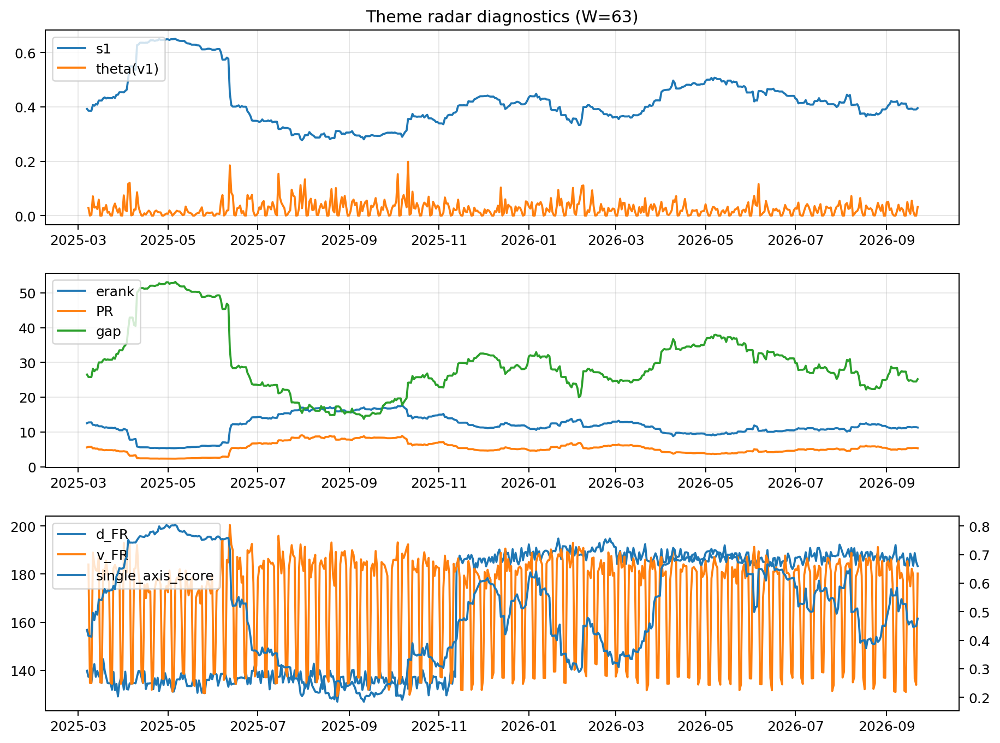

# Theme Radar Daily Brief — 2026-09-22

## Leaders (v1) — W=63
- **Nuclear_Uranium** (0.0839272352069909)
- Semis (0.0690833863508252)
- Quantum (0.0636575092581337)

## Challengers — W=63
**v2:** Rates (0.0899751981416537), Semis (0.0850995931778338), Genomics_Bio (0.0724492928486286)
**v3:** Metals (0.0910604424550343), Genomics_Bio (0.0721857721496506), Crypto (0.0665059657731059)

## Migration (20D slope) — W=63
**Top risers:**
- axis_DataCenter_Infra: 0.0005698971798612
- axis_Genomics_Bio: 0.0003055410505361
- axis_MegaCap_AI: 0.0002060558887882
- axis_Equity_US: 0.0001669806020542
- axis_Robotics: 0.0001126926507024
- axis_Quantum: 9.028161536410688e-05
- axis_Sector_Materials: 8.887615900200433e-05
- axis_Credit: 7.837528964359186e-05
- axis_Space: 7.590240386075097e-05
- axis_Grid_Power: 7.474102282598591e-05

**Top fallers:**
- axis_Defense: -0.0001092731532334
- axis_Software_Cloud: -0.0001186338983119
- axis_Metals: -0.000166520684491
- axis_Sector_Health: -0.0001705692421586
- axis_Sector_ConsStap: -0.000177841865808
- axis_Sector_RealEstate: -0.0002159653006273
- axis_Sector_Energy: -0.000272542224714
- axis_Nuclear_Uranium: -0.0003021637081476
- axis_Crypto: -0.000398491051814
- axis_Cyber: -0.0004054334166305

## Risk line (W=63)
- s1: 0.3956207949794
- theta_v1: 0.0320207317866386
- v_FR: 180.2313105581468
- single_axis_score: 0.4757522123893805

## Interpretation
**Regime:** `theme_migration`

- Action: Tomorrow watchlist: DataCenter_Infra, Genomics_Bio, MegaCap_AI, Equity_US, Robotics + v2_top1=Rates
- Action: Hedge note: normal correlation stability.

- Percentiles (W=63 history): vfr_pct=0.48, theta_pct=0.70, s1_pct=0.41, score_pct=0.45.

---
**BUNDLE_ROOT_SHA256:** `ccc7f45cfe6a5502312e0bb7ce4a7e14e8b0a41caf2222e7bdc27c75725d125d`
