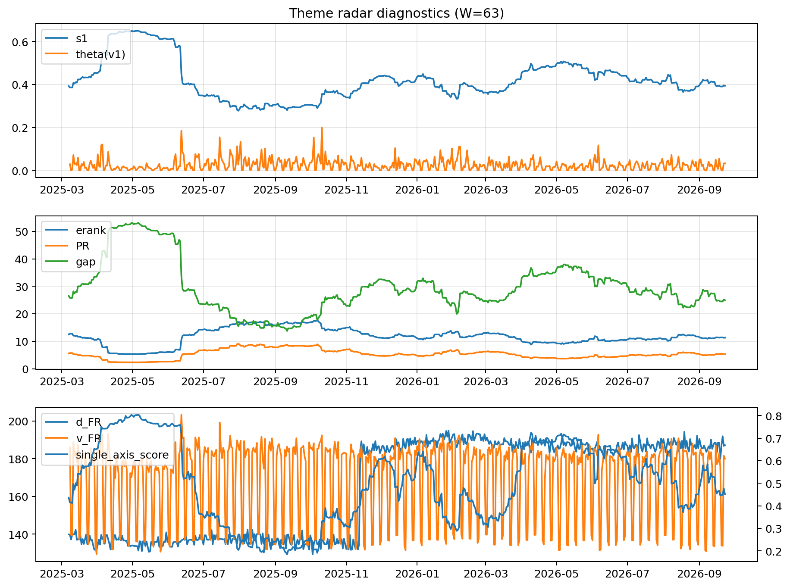

# Theme Radar Daily Brief — 2026-09-23

## Leaders (v1) — W=63
- **Nuclear_Uranium** (0.0824715801691389)
- Semis (0.0676655552890048)
- Quantum (0.0632120293677951)

## Challengers — W=63
**v2:** Semis (0.085417099812217), Rates (0.0840516469734663), Genomics_Bio (0.0768719973800462)
**v3:** Metals (0.0907291651850324), Genomics_Bio (0.0635745979728849), Software_Cloud (0.0612430870396493)

## Migration (20D slope) — W=63
**Top risers:**
- axis_DataCenter_Infra: 0.0005469726745547
- axis_Genomics_Bio: 0.0002386896366612
- axis_MegaCap_AI: 0.000203218620486
- axis_Equity_US: 0.0001705992052137
- axis_Rates: 0.0001577320948481
- axis_Robotics: 0.000114772551003
- axis_Credit: 0.0001129938522403
- axis_Sector_Utilities: 9.673487576174456e-05
- axis_Sector_Materials: 9.346382562378244e-05
- axis_Commodities: 9.2672691480525e-05

**Top fallers:**
- axis_Software_Cloud: -7.127222472844094e-05
- axis_Defense: -0.0001209030856891
- axis_Sector_Health: -0.0001719465658729
- axis_Sector_RealEstate: -0.0001831301132993
- axis_Sector_ConsStap: -0.00019162216592
- axis_Metals: -0.0002300059223057
- axis_Sector_Energy: -0.0002553458540131
- axis_Nuclear_Uranium: -0.0003082778508368
- axis_Cyber: -0.0003783545851405
- axis_Crypto: -0.0004347889805232

## Risk line (W=63)
- s1: 0.3932195775675265
- theta_v1: 0.03277627136692
- v_FR: 180.07819805848368
- single_axis_score: 0.4515901060070671

## Interpretation
**Regime:** `theme_migration`

- Action: Tomorrow watchlist: DataCenter_Infra, Genomics_Bio, MegaCap_AI, Equity_US, Rates + v2_top1=Semis
- Action: Hedge note: normal correlation stability.

- Percentiles (W=63 history): vfr_pct=0.47, theta_pct=0.71, s1_pct=0.40, score_pct=0.42.

---
**BUNDLE_ROOT_SHA256:** `3152ba49cadab77e83247495c2f5b7841d5e6e8c3e6307347f8d83ac0d42b520`
