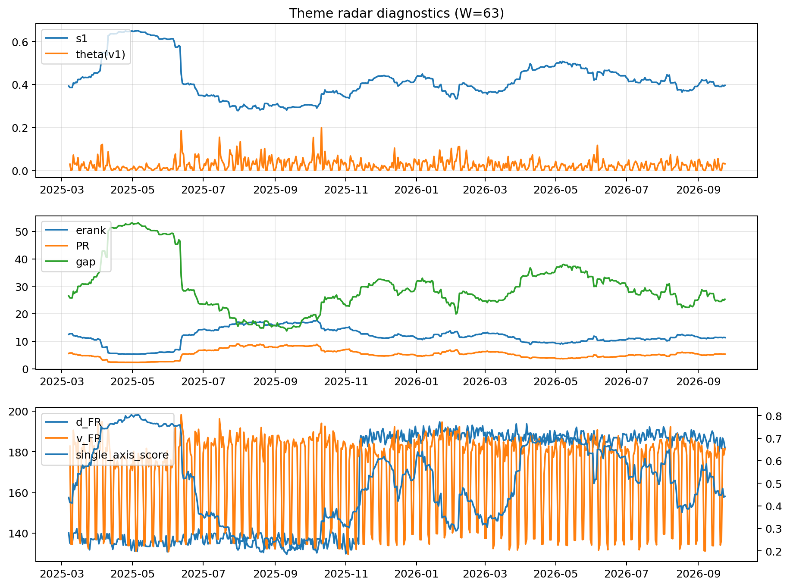

# Theme Radar Daily Brief — 2026-09-24

## Leaders (v1) — W=63
- **Nuclear_Uranium** (0.0828063945883761)
- Semis (0.0665794786198393)
- Quantum (0.0617263274969085)

## Challengers — W=63
**v2:** Semis (0.0856925342470066), Rates (0.0853607740354754), Genomics_Bio (0.0755273334726211)
**v3:** Metals (0.0839679323729157), Software_Cloud (0.0702021774488735), Genomics_Bio (0.0602063035716067)

## Migration (20D slope) — W=63
**Top risers:**
- axis_DataCenter_Infra: 0.0005234743856403
- axis_Rates: 0.0002760784004204
- axis_MegaCap_AI: 0.0001993739816781
- axis_Genomics_Bio: 0.000175831926835
- axis_Equity_US: 0.0001594896435038
- axis_Credit: 0.0001395019091512
- axis_Sector_Utilities: 0.0001362938872695
- axis_Commodities: 0.0001272287862122
- axis_Robotics: 0.0001044056202687
- axis_Sector_Materials: 8.767625860408321e-05

**Top fallers:**
- axis_Critical_Minerals: -7.628962465132432e-05
- axis_Defense: -0.0001212942058661
- axis_Sector_RealEstate: -0.0001470919134937
- axis_Sector_Health: -0.0001736680778449
- axis_Sector_ConsStap: -0.0001974451660759
- axis_Sector_Energy: -0.000231708231696
- axis_Metals: -0.0002446072487643
- axis_Nuclear_Uranium: -0.0003162062649396
- axis_Cyber: -0.0003574758099281
- axis_Crypto: -0.0004285114890337

## Risk line (W=63)
- s1: 0.3960555697588233
- theta_v1: 0.0301977595081563
- v_FR: 181.4560402335764
- single_axis_score: 0.4423280423280423

## Interpretation
**Regime:** `theme_migration`

- Action: Tomorrow watchlist: DataCenter_Infra, Rates, MegaCap_AI, Genomics_Bio, Equity_US + v2_top1=Semis
- Action: Hedge note: normal correlation stability.

- Percentiles (W=63 history): vfr_pct=0.54, theta_pct=0.67, s1_pct=0.41, score_pct=0.40.

---
**BUNDLE_ROOT_SHA256:** `8323ec222e899a3e002d5ca97c578511392fe319fce683dc1c2db06e3480de93`
