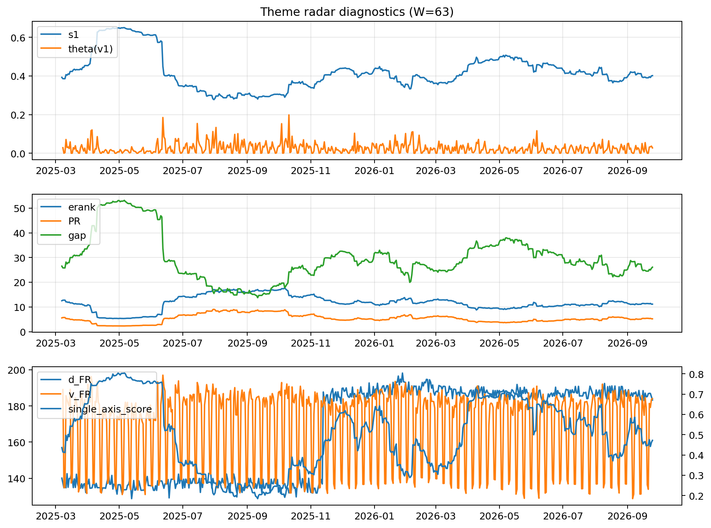

# Theme Radar Daily Brief — 2026-09-25

## Leaders (v1) — W=63
- **Nuclear_Uranium** (0.0826209039623564)
- Semis (0.0665501106571482)
- Quantum (0.059994980236933)

## Challengers — W=63
**v2:** Semis (0.0894079722992192), Rates (0.0887105926445201), Genomics_Bio (0.0813942441221187)
**v3:** Metals (0.0802020596292842), Software_Cloud (0.0747970681988799), MegaCap_AI (0.0582416542800158)

## Migration (20D slope) — W=63
**Top risers:**
- axis_DataCenter_Infra: 0.000496349578847
- axis_Rates: 0.0004035753728134
- axis_Sector_Utilities: 0.0001806217736159
- axis_Credit: 0.0001737177180382
- axis_Commodities: 0.0001680236761268
- axis_MegaCap_AI: 0.0001623816836328
- axis_Equity_US: 0.0001506752035177
- axis_Genomics_Bio: 0.0001415350329456
- axis_Sector_Materials: 0.0001075821779958
- axis_Robotics: 9.592201730541278e-05

**Top fallers:**
- axis_Critical_Minerals: -7.706356016562328e-05
- axis_Sector_RealEstate: -0.0001045421614082
- axis_Defense: -0.0001187409432403
- axis_Sector_Health: -0.0001877137402797
- axis_Sector_Energy: -0.0001984731812891
- axis_Sector_ConsStap: -0.000222903223029
- axis_Metals: -0.0002431880710727
- axis_Nuclear_Uranium: -0.0003247884435875
- axis_Cyber: -0.0003479969653724
- axis_Crypto: -0.0004344769592062

## Risk line (W=63)
- s1: 0.401498628015539
- theta_v1: 0.0275921987633348
- v_FR: 184.06121084326867
- single_axis_score: 0.4721830985915494

## Interpretation
**Regime:** `theme_migration`

- Action: Tomorrow watchlist: DataCenter_Infra, Rates, Sector_Utilities, Credit, Commodities + v2_top1=Semis
- Action: Hedge note: normal correlation stability.

- Percentiles (W=63 history): vfr_pct=0.73, theta_pct=0.62, s1_pct=0.45, score_pct=0.44.

---
**BUNDLE_ROOT_SHA256:** `85e9daf617b21c04507d22f71419952dc3034c6d4649d3531098b01051e3517b`
