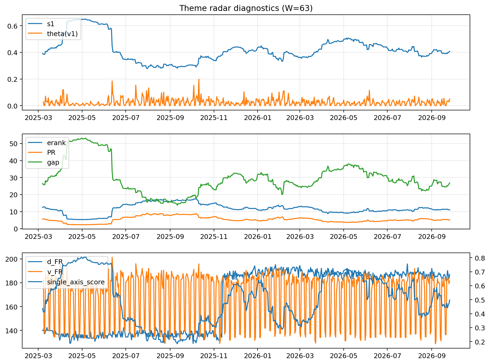

# Theme Radar Daily Brief — 2026-09-26

## Leaders (v1) — W=63
- **Nuclear_Uranium** (0.0814562854606299)
- Semis (0.0658939765627375)
- Space (0.0596045206240489)

## Challengers — W=63
**v2:** Genomics_Bio (0.0907672152199791), Semis (0.0874675362517656), Rates (0.0822397181503404)
**v3:** Metals (0.0780457355422854), Software_Cloud (0.0776613281540798), MegaCap_AI (0.059398714750034)

## Migration (20D slope) — W=63
**Top risers:**
- axis_DataCenter_Infra: 0.000553203504192
- axis_Rates: 0.0005161295328718
- axis_Sector_Utilities: 0.0002248970859561
- axis_Commodities: 0.0002030410513952
- axis_Credit: 0.0001954502095263
- axis_Equity_US: 0.0001335978205779
- axis_Sector_Materials: 0.0001221680806967
- axis_MegaCap_AI: 0.0001114804759176
- axis_Sector_ConsDisc: 9.370466256345225e-05
- axis_Sector_Ind: 8.262302438621685e-05

**Top fallers:**
- axis_Quantum: -8.772753826300805e-05
- axis_Defense: -9.218110823907168e-05
- axis_Critical_Minerals: -9.29874869912468e-05
- axis_Sector_Energy: -0.0001651449200943
- axis_Sector_Health: -0.0001907212276699
- axis_Sector_ConsStap: -0.0002309496233021
- axis_Metals: -0.000249437927226
- axis_Cyber: -0.0003306473559556
- axis_Nuclear_Uranium: -0.0003328044830294
- axis_Crypto: -0.000443133868391

## Risk line (W=63)
- s1: 0.407519695988718
- theta_v1: 0.0504322290130758
- v_FR: 181.4109021131057
- single_axis_score: 0.4973637961335676

## Interpretation
**Regime:** `theme_migration`

- Action: Tomorrow watchlist: DataCenter_Infra, Rates, Sector_Utilities, Commodities, Credit + v2_top1=Genomics_Bio
- Action: Hedge note: normal correlation stability.

- Percentiles (W=63 history): vfr_pct=0.54, theta_pct=0.87, s1_pct=0.49, score_pct=0.47.

---
**BUNDLE_ROOT_SHA256:** `b257985a776f2d3f58c44953c68f63b2cc89fdda9387c1bee45213c57bf7884e`
