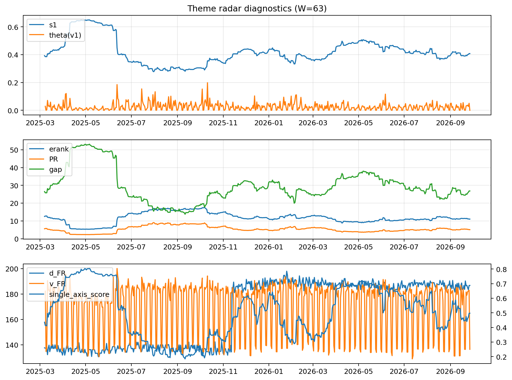

# Theme Radar Daily Brief — 2026-09-27

## Leaders (v1) — W=63
- **Nuclear_Uranium** (0.0814562108497897)
- Semis (0.0658939743627042)
- Space (0.0596045406136148)

## Challengers — W=63
**v2:** Genomics_Bio (0.090768322082253), Semis (0.087467494692329), Rates (0.0822362231800535)
**v3:** Metals (0.0780500673459422), Software_Cloud (0.0776551019784218), MegaCap_AI (0.0593974321136768)

## Migration (20D slope) — W=63
**Top risers:**
- axis_Rates: 0.0006161345591917
- axis_DataCenter_Infra: 0.0005861169137595
- axis_Sector_Utilities: 0.0002644475238666
- axis_Commodities: 0.0002320481567437
- axis_Credit: 0.0002129893058542
- axis_Sector_Materials: 0.0001331846501758
- axis_Equity_US: 0.0001140921172841
- axis_Sector_ConsDisc: 0.0001099406157636
- axis_Sector_Ind: 9.553968550603773e-05
- axis_Sector_Fin: 6.985674482650473e-05

**Top fallers:**
- axis_Space: -0.0001205369052346
- axis_Sector_Energy: -0.0001277286262721
- axis_Semis: -0.0001319997705555
- axis_Quantum: -0.0001491175619867
- axis_Sector_Health: -0.0001881753213231
- axis_Sector_ConsStap: -0.0002325831175076
- axis_Metals: -0.0002485259823667
- axis_Cyber: -0.0003049088413325
- axis_Nuclear_Uranium: -0.000330315730532
- axis_Crypto: -0.0004407609627727

## Risk line (W=63)
- s1: 0.4075197326284541
- theta_v1: 5.55245739928684e-06
- v_FR: 136.43891987263592
- single_axis_score: 0.4975438596491227

## Interpretation
**Regime:** `theme_migration`

- Action: Tomorrow watchlist: Rates, DataCenter_Infra, Sector_Utilities, Commodities, Credit + v2_top1=Genomics_Bio
- Action: Hedge note: normal correlation stability.

- Percentiles (W=63 history): vfr_pct=0.13, theta_pct=0.01, s1_pct=0.49, score_pct=0.47.

---
**BUNDLE_ROOT_SHA256:** `61b039391b1166771eeb3b5ceb108a20050317730ee3b8fe162d99a1be050d2b`
