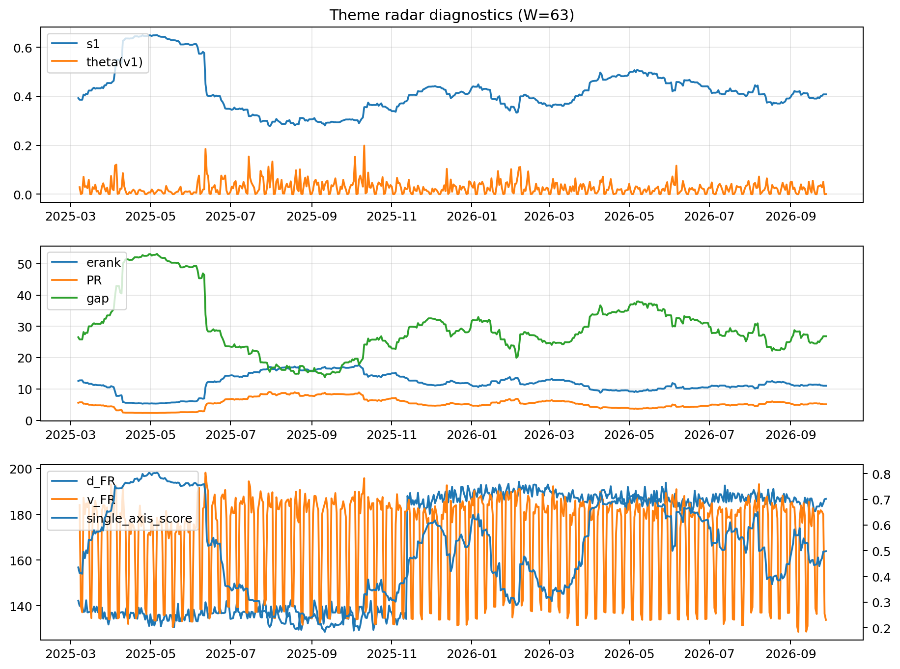

# Theme Radar Daily Brief — 2026-09-28

## Leaders (v1) — W=63
- **Nuclear_Uranium** (0.0814496736395376)
- Semis (0.0658866023124585)
- Space (0.0595975928200211)

## Challengers — W=63
**v2:** Genomics_Bio (0.0908082884778824), Semis (0.0873867088269395), Rates (0.0821098266262474)
**v3:** Metals (0.0780642907058745), Software_Cloud (0.0776162887425842), MegaCap_AI (0.0593618204262002)

## Migration (20D slope) — W=63
**Top risers:**
- axis_Rates: 0.0006969067574939
- axis_DataCenter_Infra: 0.0005974905451042
- axis_Sector_Utilities: 0.0002940671292509
- axis_Commodities: 0.0002613661302642
- axis_Credit: 0.0002237844243147
- axis_Sector_Materials: 0.0001410210044173
- axis_Sector_ConsDisc: 0.0001210739398195
- axis_Sector_Ind: 0.0001047379280787
- axis_Equity_US: 9.024778388255397e-05
- axis_Sector_RealEstate: 8.289143011037774e-05

**Top fallers:**
- axis_Space: -0.0001374860536511
- axis_Genomics_Bio: -0.0001577230351094
- axis_Sector_Health: -0.0001836327623267
- axis_Semis: -0.0001860768563264
- axis_Quantum: -0.0002017058368755
- axis_Sector_ConsStap: -0.0002303010606112
- axis_Metals: -0.0002458927691028
- axis_Cyber: -0.0002777179436684
- axis_Nuclear_Uranium: -0.0003142696028602
- axis_Crypto: -0.0004291469994

## Risk line (W=63)
- s1: 0.4075386875127684
- theta_v1: 0.0005140944756302
- v_FR: 133.86483280470844
- single_axis_score: 0.4984238178633975

## Interpretation
**Regime:** `theme_migration`

- Action: Tomorrow watchlist: Rates, DataCenter_Infra, Sector_Utilities, Commodities, Credit + v2_top1=Genomics_Bio
- Action: Hedge note: normal correlation stability.

- Percentiles (W=63 history): vfr_pct=0.05, theta_pct=0.18, s1_pct=0.49, score_pct=0.47.

---
**BUNDLE_ROOT_SHA256:** `dc152f1ea6dbb3884a80dd07f2c75b22dcdd1f50268e41259a6c32d410dc5b8e`
