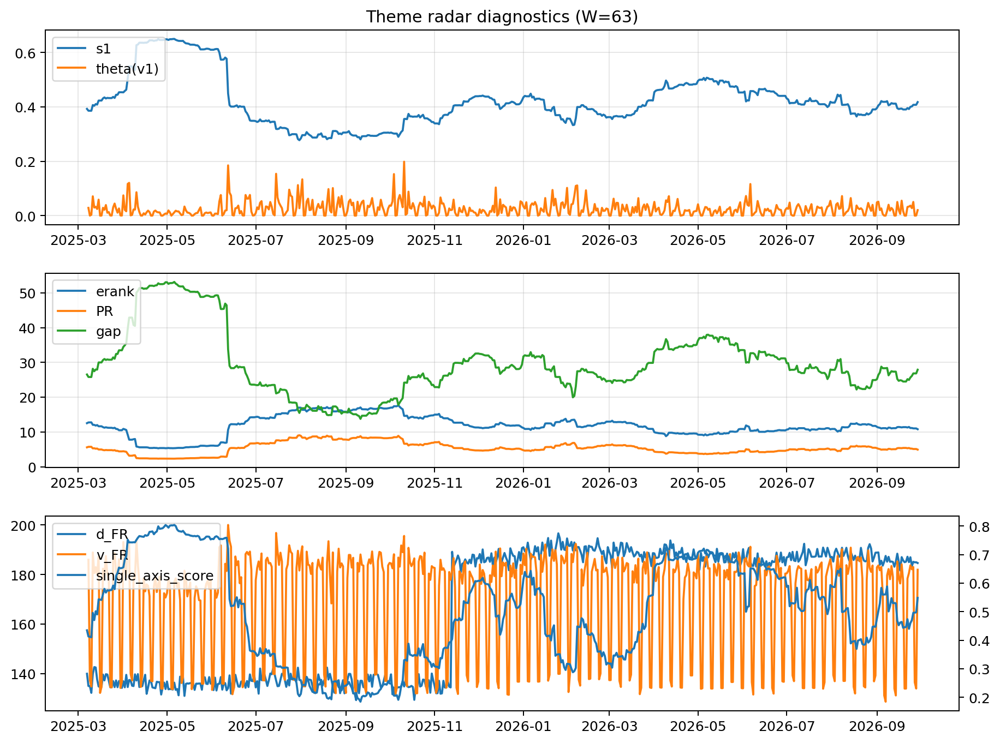

# Theme Radar Daily Brief — 2026-09-29

## Leaders (v1) — W=63
- **Nuclear_Uranium** (0.0804881289114133)
- Semis (0.0664680820133879)
- Quantum (0.0601235089272413)

## Challengers — W=63
**v2:** Genomics_Bio (0.0935211058769774), Rates (0.0839309847298643), Semis (0.0826535801594431)
**v3:** Software_Cloud (0.0850392467103398), Metals (0.0799602696602266), MegaCap_AI (0.0644934490390617)

## Migration (20D slope) — W=63
**Top risers:**
- axis_Rates: 0.0007192863930895
- axis_DataCenter_Infra: 0.0006427512970393
- axis_Sector_Utilities: 0.0003092672961258
- axis_Commodities: 0.0002737645680747
- axis_Credit: 0.0002200826141847
- axis_Sector_Materials: 0.0001367575073205
- axis_Sector_ConsDisc: 0.0001302720852213
- axis_Sector_RealEstate: 0.0001289439227252
- axis_Sector_Ind: 0.0001047255107889
- axis_Sector_Fin: 7.046856105368724e-05

**Top fallers:**
- axis_Space: -0.0001518374860687
- axis_Sector_Health: -0.0001807696759125
- axis_Sector_ConsStap: -0.0002148921200271
- axis_Quantum: -0.0002219933309741
- axis_Semis: -0.0002220368386734
- axis_Metals: -0.0002279057115922
- axis_Genomics_Bio: -0.0002292625802318
- axis_Cyber: -0.0002468447764262
- axis_Nuclear_Uranium: -0.0003105158212768
- axis_Crypto: -0.000414457158205

## Risk line (W=63)
- s1: 0.417600820157827
- theta_v1: 0.0204145460421504
- v_FR: 181.93484569267616
- single_axis_score: 0.5486013986013986

## Interpretation
**Regime:** `theme_migration`

- Action: Tomorrow watchlist: Rates, DataCenter_Infra, Sector_Utilities, Commodities, Credit + v2_top1=Genomics_Bio
- Action: Hedge note: normal correlation stability.

- Percentiles (W=63 history): vfr_pct=0.59, theta_pct=0.52, s1_pct=0.57, score_pct=0.57.

---
**BUNDLE_ROOT_SHA256:** `6de0fad657021cd5e8e355557b86c10bf6d6950b646d4dfb6570c39d9ee4071d`
